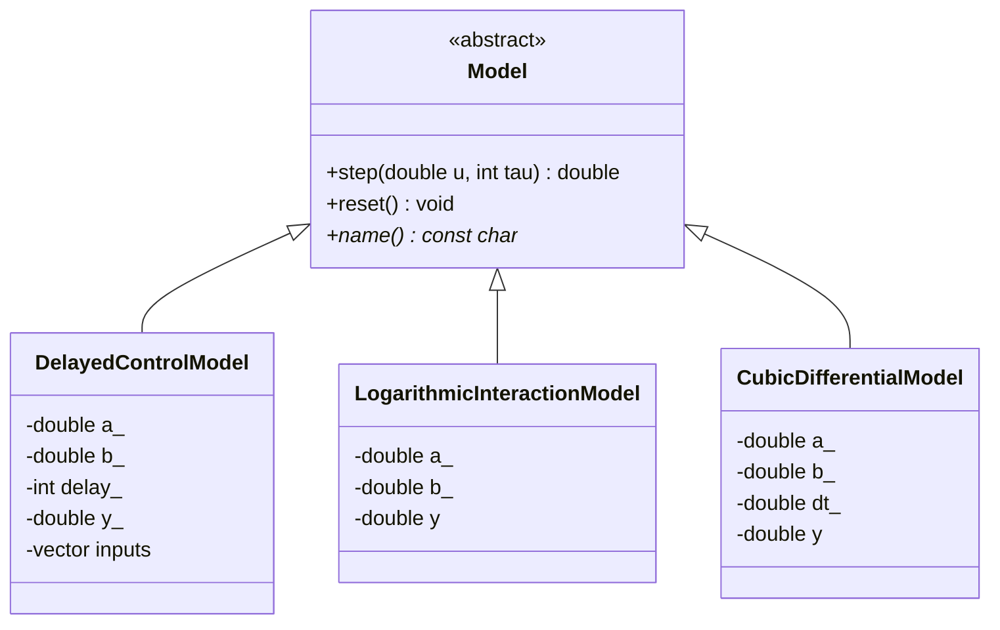
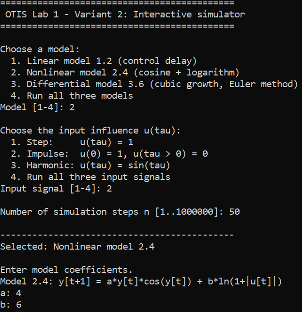
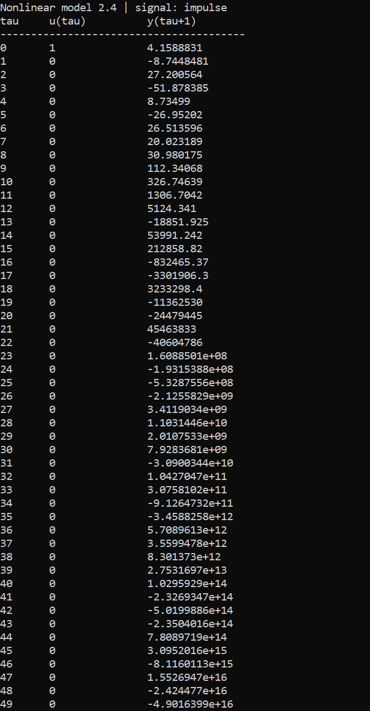
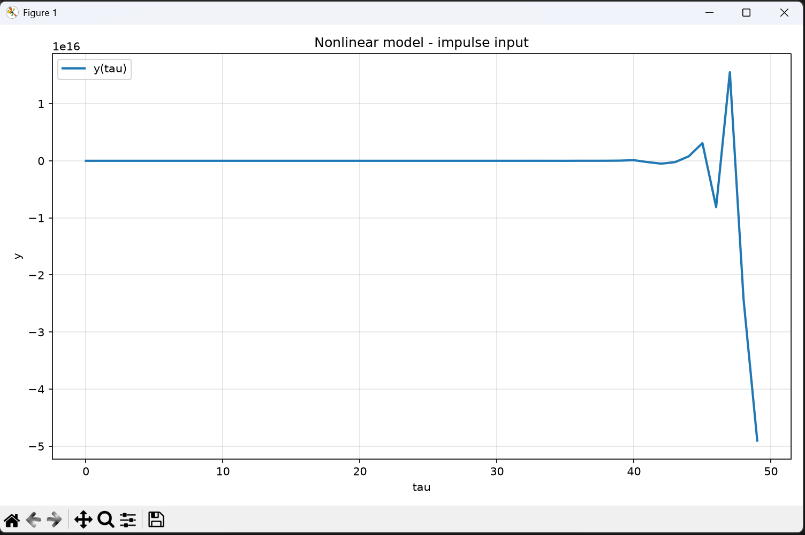

<p align="center"> Министерство образования Республики Беларусь</p>
<p align="center">Учреждение образования</p>
<p align="center">“Брестский Государственный технический университет”</p>
<p align="center">Кафедра ИИТ</p>
<br><br><br><br><br><br><br>
<p align="center">Лабораторная работа №1</p>
<p align="center">По дисциплине “Общая теория интеллектуальных систем”</p>
<p align="center">Тема: “Моделирования температуры объекта”</p>
<br><br><br><br><br>
<p align="right">Выполнила:</p>
<p align="right">Студентка 2 курса</p>
<p align="right">Группы ИИ-30</p>
<p align="right">Свитич С. Ю.</p>
<p align="right">Проверил:</p>
<p align="right">Дворанинович Д. А.</p>
<br><br><br><br><br>
<p align="center">Брест 2026</p>


# Вариант 2

## Цель работы

Разработать программу на C++ для моделирования управляемого объекта с использованием объектно-ориентированного подхода. Реализовать три заданные математические модели, три типа входного воздействия, настраиваемое число шагов, вывод результатов в консоль, сохранение данных в CSV и построение графиков с помощью Python.

## Математические модели

### 1. Линейная модель 1.2 — запаздывание управления

\[
y_{\tau+1}=a y_\tau+b u_{\tau-k}, \quad k\ge 1.
\]

В реализации значения управления до появления доступного отсчёта с учётом задержки принимаются равными нулю.

### 2. Нелинейная модель 2.4 — косинус и логарифм

\[
y_{\tau+1}=a y_\tau\cos(y_\tau)+b\ln(1+|u_\tau|).
\]

### 3. Дифференциальная модель 3.6 — кубическая динамика

\[
\frac{dy}{dt}=a y^3+b u.
\]

Для численного решения применяется явный метод Эйлера:

\[
y_{\tau+1}=y_\tau+\Delta t\left(a y_\tau^3+b u_\tau\right).
\]

## Входные воздействия

- **Ступенчатое:** \(u_\tau=1\).
- **Импульсное:** \(u_0=1\), \(u_{\tau>0}=0\).
- **Гармоническое:** \(u_\tau=\sin(\tau)\), аргумент синуса задаётся в радианах.

Пользователь выбирает модель, тип воздействия, число шагов и коэффициенты модели в интерактивном меню. Предусмотрены варианты запуска всех моделей и всех типов воздействия.

## Архитектура программы

Абстрактный класс `otis::Model` задаёт общий интерфейс для моделирования. Три производных класса реализуют соответствующие уравнения:

- `DelayedControlModel` — линейная модель с задержкой управления;
- `LogarithmicInteractionModel` — нелинейная модель;
- `CubicDifferentialModel` — дифференциальная модель с методом Эйлера.

Модуль генерации сигналов отделён от моделей. Функция симуляции выполняет расчёт и сохраняет значения в CSV. После завершения моделирования основная программа автоматически запускает `plot.py`, который считывает CSV-файлы и строит PNG-графики с помощью Matplotlib.



## Структура исходного кода

- `src/main.cpp` — точка входа, меню, ввод параметров и запуск сценариев.
- `src/model.hpp` — абстрактный базовый класс `Model`.
- `src/models.hpp`, `src/models.cpp` — объявления и реализация трёх моделей.
- `src/signals.hpp`, `src/signals.cpp` — типы и генерация входных воздействий.
- `src/simulator.hpp`, `src/simulator.cpp` — моделирование, вывод таблиц и экспорт CSV.
- `src/plot.py` — построение графиков PNG с использованием Matplotlib.
- `src/CMakeLists.txt`, `CMakeLists.txt` — конфигурация сборки через CMake.
- `src/build.bat`, `src/run.bat` — скрипты сборки и запуска для Windows.

## Сборка и запуск в Windows

1. Установить CMake и компилятор C++17. Подойдут Visual Studio Build Tools с компонентом **Desktop development with C++** или MinGW-w64 с `g++` и `mingw32-make`.
2. Установить Python 3 и Matplotlib:

   ```bat
   python -m pip install matplotlib
   ```

3. Из каталога `src` выполнить `build.bat`.
4. Запустить `run.bat`. Программа запросит модель, входное воздействие, число шагов и коэффициенты. Количество шагов также можно передать аргументом, например `run.bat 100`.

После успешного моделирования `plot.py` запускается автоматически. Графики сохраняются в PNG-файлы, но в текущей реализации отдельные окна графиков не открываются.

## Выходные данные

Результаты сохраняются в каталоге `results`, расположенном рядом с исполняемым файлом:

- CSV-файлы: `results/<model>/<signal>.csv`;
- графики: `results/<model>_<signal>.png`.

Вместо накопления результатов разных запусков каталог `results` очищается в начале каждой новой симуляции. Поэтому в нём остаются только результаты последнего запуска. Для просмотра графика откройте соответствующий PNG-файл.

## Пример работы программы

Сперва мы выбираем модель, а после тип входного влияния, после чего вводим значения:



Программа выводит таблицу значений и автоматически запускает визуализацию:




## Вывод

В работе реализованы три модели варианта 2 с использованием абстрактного базового класса и наследования. Программа поддерживает ступенчатое, импульсное и гармоническое воздействия, настраиваемое число шагов и параметров, вывод результатов в консоль, экспорт в CSV и автоматическое построение графиков PNG через Python и Matplotlib.
