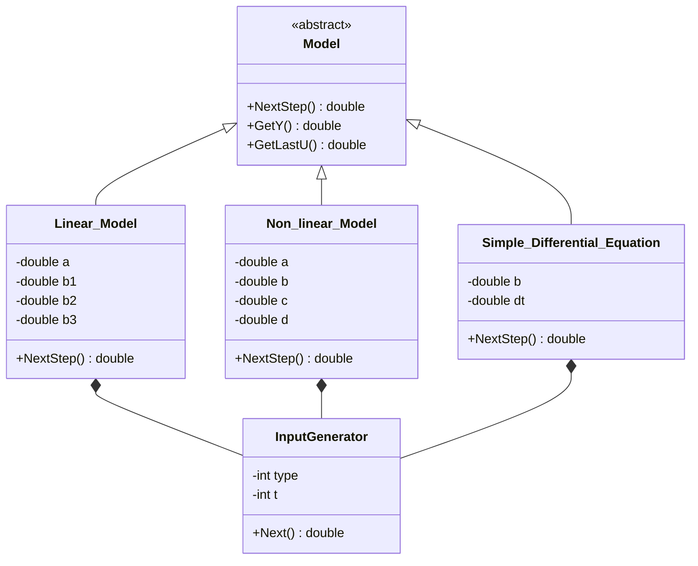
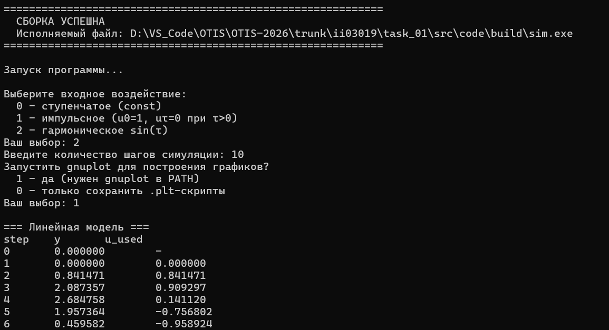
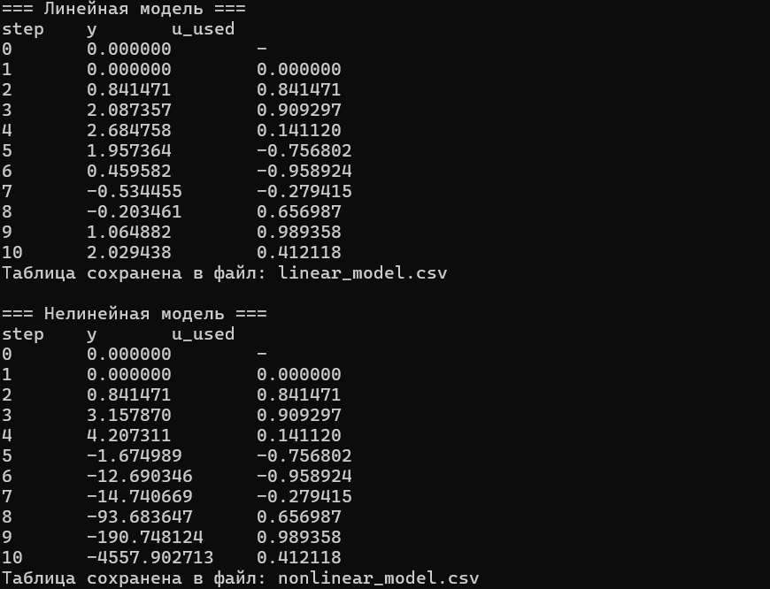
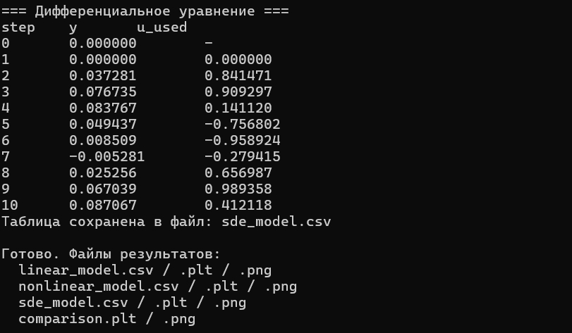
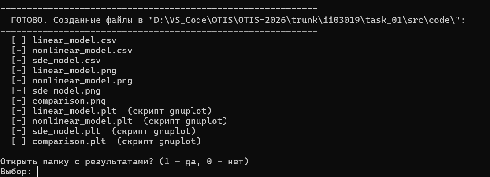
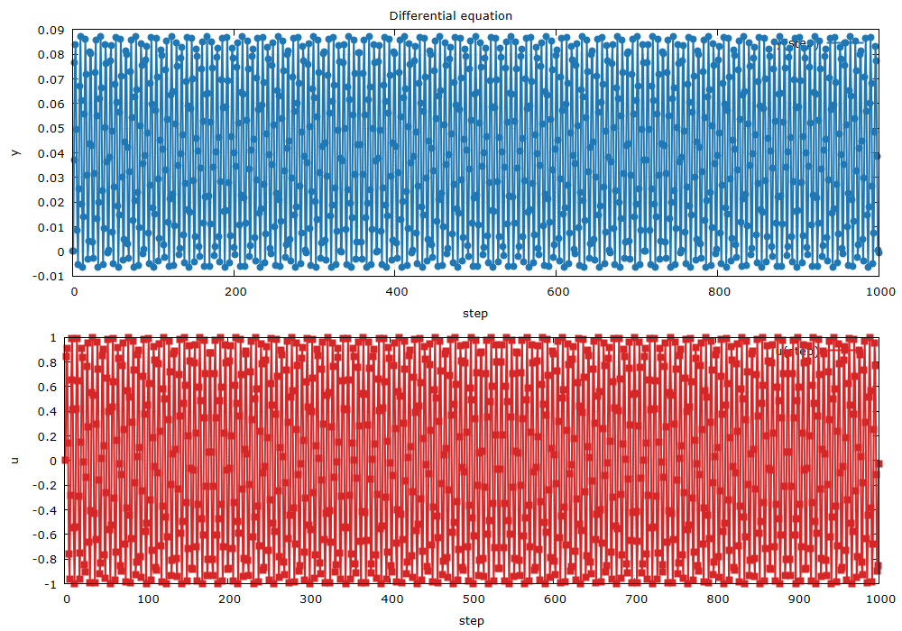

 Министерство образования Республики Беларусь

Учреждение образования

«Брестский государственный технический университет»

Кафедра ИИТ

       

Лабораторная работа №1

По дисциплине «Общая теория интеллектуальных систем»

За 3 семестр

Тема: «Моделирование температуры объекта»

Вариант 17

     

Выполнил:

Студент ФЭИС

Группы ИИ-30

Самута А.Л.

Проверил:

Дворанинович Д.А.

     

Брест 2026

 

## 1. Цель работы

Освоить приемы математического моделирования, проектирования и программирования объектов различной природы на языке C++. Спроектировать программу, которая реализовывает три объекта (линейное уравнение, нелинейное и дифференциальное), выводит результат в табличном виде и строит графики уравнений.

## 2. Постановка задачи

В соответствии с вариантом 17 необходимо реализовать три математические модели:

| Блок | Модель | Тип | Название |
|:--:|:--:|:--:|---|
| 1 | 1.7 | Линейное | System with Multi-Step Control History |
| 2 | 2.1 | Нелинейное | Quadratic Feedback and Harmonic Control |
| 3 | 3.5 | Дифференциальное | Harmonic Driving Force |

Требования к реализации:
*   язык C++, принципы ООП; абстрактный базовый класс модели и виртуальные методы;
*   три вида входного воздействия: 
    *   ступенчатое $u(\tau) = const$;
    *   импульсное $u(0) = 1, u(\tau>0) = 0$;
    *   гармоническое $u(\tau) = \sin(\tau)$;
*   ввод числа шагов $n$ и константного входного воздействия $u$ во время работы программы;
*   табличный вывод результатов в консоль и сохранение в CSV-файл;
*   построение графиков результатов (с использованием утилиты gnuplot);
*   сборка проекта через CMake, запуск сборки и демонстрация — bat-файлом.

## 3. Математическое описание

В программе реализованы три типа моделей: две дискретные и одна непрерывная. Все уравнения реализованы в соответствующих классах-наследниках.

### 3.1. Линейная дискретная модель (класс Linear_Model)

$$y_{\tau+1} = a \cdot y_{\tau} + b_1 \cdot u_{\tau} + b_2 \cdot u_{\tau-1} + b_3 \cdot u_{\tau-2}$$

Описание. Это обобщённая линейная авторегрессионная модель. Выход на следующем шаге зависит от предыдущего значения самого выхода (авторегрессия первого порядка) и от текущего и двух предыдущих значений входа (внешнего воздействия). Коэффициент $a$ определяет собственную инерционность объекта, а коэффициенты $b_1, b_2, b_3$ — способ передачи воздействия и запаздывание (задержку) сигнала.

Примечание об устойчивости. Устойчивость модели определяется характеристическим уравнением $z - a = 0$. Система будет сходящейся, если корень уравнения (полюс) лежит внутри единичной окружности на Z-плоскости: $|z| = |a| < 1$.

### 3.2. Нелинейная дискретная модель (класс Non_linear_Model)

$$y_{\tau+1} = a \cdot y_{\tau} - b \cdot (y_{\tau-1})^2 + c \cdot u_{\tau} + d \cdot \sin(u_{\tau-1})$$

Описание. Модель содержит два нелинейных члена:
1. $-b \cdot (y_{\tau-1})^2$ — квадратичное затухание/рост, зависящее от выхода на предыдущем шаге.
2. $d \cdot \sin(u_{\tau-1})$ — нелинейное преобразование входного сигнала на шаге $\tau-1$, что может имитировать нелинейную характеристику исполнительного механизма (например, клапана или привода).

Такая модель способна описывать более сложную динамику, включая автоколебания и зависимость установившегося режима от амплитуды входного сигнала.

### 3.3. Дифференциальное уравнение (класс Simple_Differential_Equation)

В отличие от первых двух, этот объект является непрерывным и описывается дифференциальным уравнением первого порядка:

$$\frac{dy}{dt} = b \cdot \sin(u)$$
Численное решение. Для интегрирования уравнения в программе используется явный метод Эйлера с шагом дискретизации $\Delta t$ (в коде — dt). Производная $\frac{dy}{dt}$ заменяется конечной разностью:

$$\frac{y_{\tau+1} - y_{\tau}}{\Delta t} \approx b \cdot \sin(u_{\tau})$$

Отсюда получаем разностную схему, которая реализована в методе NextStep():

$$y_{\tau+1} = y_{\tau} + \Delta t \cdot b \cdot \sin(u_{\tau})$$

Анализ шага $\Delta t$. Точность метода Эйлера напрямую зависит от величины шага. Чем меньше $\Delta t$, тем ближе численное решение к истинному. Если задать слишком большой шаг, численная схема может стать неустойчивой (появится расходимость), даже если исходное дифференциальное уравнение стабильно.

Физический смысл. Уравнение описывает скорость изменения некой величины $y$, которая зависит от синусоидального внешнего воздействия $u$. При постоянном входе $u$ скорость изменения $dy/dt$ постоянна, и решение представляет собой прямую линию (линейный рост или спад).

## 4. Архитектура программы

Программа построена на основе принципов объектно-ориентированного программирования. В центре архитектуры находится абстрактный базовый класс Model, который задаёт единый интерфейс для любой математической модели. Это позволяет реализовать полиморфизм: основной цикл симуляции и модули вывода работают с объектами через ссылку на базовый класс, не зная их конкретного типа.

Каждая из трёх моделей наследует Model, реализует чисто виртуальные методы и хранит собственное состояние. Также в каждую модель инкапсулирован объект InputGenerator, отвечающий за генерацию входного воздействия $u(\tau)$.

Для соблюдения принципа единственной ответственности код разделён на независимые модули:
*   **TableOutput** — отвечает за прогон симуляции, сбор данных SimRow, вывод таблиц в консоль и сохранение в CSV-файл.
*   **Plotter** — генерирует скрипты .plt для утилиты gnuplot и вызывает её для построения графиков (как для отдельных моделей, так и сводного графика для сравнения).

*Рис. 1. Иерархия классов программы*

## 5. Сборка

Сборка проекта осуществляется с использованием системы CMake. Для автоматизации процесса и демонстрации сборки используется скрипт build.bat.

Скрипт выполняет следующие шаги:
1. Проверяет наличие CMake и компилятора (MinGW g++ или MSVC) в системе.
2. Проверяет наличие всех исходных файлов в папке проекта.
3. Выполняет конфигурацию проекта (cmake -S . -B build).
4. Запускает компиляцию (cmake --build build --config Release).
5. Автоматически запускает полученный исполняемый файл.
6. Выводит отчет о созданных файлах (CSV и PNG) и предлагает открыть папку с результатами.

## 6. Результаты моделирования

Программа позволяет пользователю в интерактивном режиме выбрать тип входного воздействия (ступенчатое, импульсное или гармоническое), задать его параметры (если требуется) и указать количество шагов симуляции.
В процессе работы программа:
1. Выводит в консоль таблицу с результатами (шаг $\tau$, вход $u$, выход $y$) для каждой из трех моделей.
2. Сохраняет результаты в файлы linear_model.csv, nonlinear_model.csv, sde_model.csv.
3. С помощью модуля Plotter генерирует .plt-скрипты и вызывает gnuplot, создавая графики переходных процессов (linear_model.png, nonlinear_model.png, sde_model.png).
4. Строит сводный график comparison.png, на котором наглядно видно различие в поведении трех моделей при одинаковом входном воздействии.

*Рис. 2. Демонстрация работы*

*Рис. 3. Демонстрация работы*

*Рис. 4. Демонстрация работы*

*Рис. 5. Демонстрация работы*

*Рис. 5. Демонстрация файла графиков для дифференциального уравнения с 1000 шагов*

## 7. Выводы

В ходе выполнения лабораторной работы была разработана программа на языке C++, моделирующая поведение трёх управляемых объектов (вариант 17). 

Были успешно применены принципы ООП: абстрактный базовый класс Model позволил реализовать единый цикл симуляции для трёх разных по своей природе уравнений (линейного, нелинейного и дифференциального). Модульность программы (выделение генератора сигналов, модуля вывода и модуля графиков) обеспечила гибкость и лёгкость расширения кода.

Также были реализованы защищённый ввод параметров во время выполнения, автоматическое сохранение данных в CSV-формат, визуализация с помощью gnuplot и автоматизация процесса сборки через CMake и .bat-файл. Цель работы достигнута в полном объеме.

## 8. Приложение. Состав проекта

| Файл | Назначение |
|---|---|
| Model.h | абстрактный базовый класс |
| InputGenerator.h/.cpp | генератор входных воздействий |
| Linear_Model.h/.cpp | модель 1.7 |
| Non_linear_Model.h/.cpp | модель 2.1 |
| Simple_Differential_Equation.h/.cpp | модель 3.5 |
| TableOutput.h/.cpp | сбор данных, вывод таблиц, сохранение CSV |
| Plotter.h/.cpp | построение графиков через gnuplot |
| main.cpp | точка входа, меню, оркестрация |
| CMakeLists.txt | правила сборки |
| build.bat | скрипт автоматической сборки и запуска |