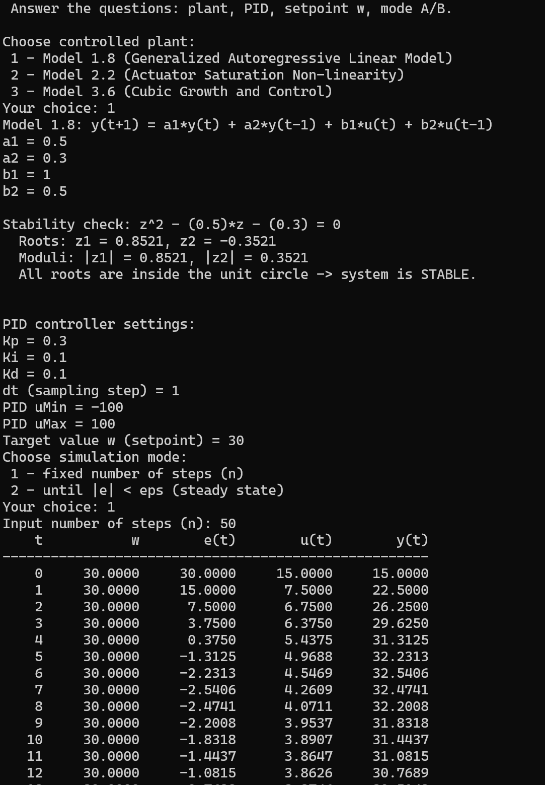
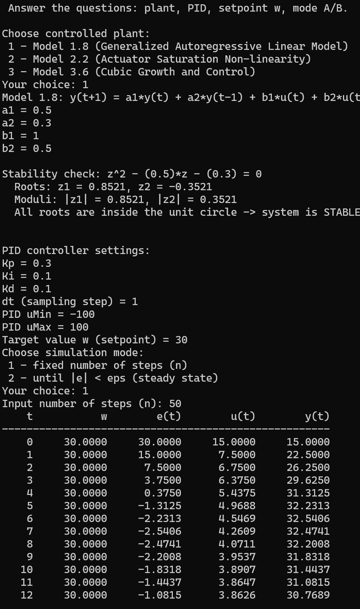

<p align="center"> Министерство образования Республики Беларусь</p>
<p align="center">Учреждение образования</p>
<p align="center">“Брестский Государственный технический университет”</p>
<p align="center">Кафедра ИИТ</p>
<br><br><br><br><br><br><br>
<p align="center">Лабораторная работа №3</p>
<p align="center">По дисциплине “Общая теория интеллектуальных систем”</p>
<p align="center">Тема: “Моделирования температуры объекта”</p>
<br><br><br><br><br>
<p align="right">Выполнил:</p>
<p align="right">Студент 2 курса</p>
<p align="right">Группы ИИ-30</p>
<p align="right">Семенюк А. С.</p>
<p align="right">Проверил:</p>
<p align="right">Дворанинович Д. А.</p>
<br><br><br><br><br>
<p align="center">Брест 2026</p>


---

## 1. Цель работы

Собрать **замкнутую систему автоматического управления**: подключить к
математическим моделям объектов из лабораторной работы №1 ПИД-регулятор
(дискретный «алгоритм скорости») и исследовать переходный процесс: выход
объекта на заданное значение, влияние коэффициентов $K_p, K_i, K_d$ на
качество регулирования. Закрепить навыки модульного тестирования (Google Test)
и автоматического документирования кода (Doxygen + GitHub Pages).

## 2. Постановка задачи (требования методички)

1. Отчёт — `task_03/doc/readme.md` (настоящий файл);
2. исходный код в `src/`;
3. строка о работе в общий readme репозитория;
4. документирование кодом Doxygen, результат — `doc/html` + GitHub Pages;
5. модульные тесты на Google Test в `test/`;
6. программа выводит результаты **строго таблицей** `t, w, e(t), u(t), y(t)`;
7. графики переходных процессов (через Python/matplotlib);
8. bat-файл полного цикла (сборка → тесты → документация);
9. объект управления = любая из **трёх моделей ЛР1**, выбор — в меню;
10. **два режима работы**: А — заданное число тактов $n$; Б — до достижения
    установившегося режима $|e| < \varepsilon$;
11. в отчёте — графики при разных заданиях $w$ и **пошаговая история
    настройки** коэффициентов регулятора.

## 3. ПИД-регулятор: методика и реализация

Классически управление регулятора: $u(t) = K_p\,e + K_i\!\int e\,dt + K_d\,\frac{de}{dt}$,
где $e(t) = w - y(t)$. По методичке используется его дискретная **рекуррентная
форма («алгоритм скорости»)** — считается приращение управления:

$$
u(t) = u(t-1) + \Delta u(t), \qquad
\Delta u(t) = q_0 e(t) + q_1 e(t-1) + q_2 e(t-2),
$$

$$
q_0 = K_p\!\left(1 + \tfrac{K_d}{dt}\right),\quad
q_1 = -K_p\!\left(1 + 2\tfrac{K_d}{dt} - \tfrac{K_i}{K_p}\,dt\right),\quad
q_2 = K_p \tfrac{K_d}{dt}.
$$

В коде (`src/PIDController.h`) — эквивалентная развёрнутая запись (та же
формула после подстановки $q_0, q_1, q_2$ и сбора слагаемых):

```cpp
double dU = Kp * (e - e_prev1)              // P: приращение ошибки
          + Ki * e * dt                     // I: накопление, Ki уже включает dt-поправки
          + (Kd / dt) * (e - 2.0 * e_prev1 + e_prev2);  // D: вторая разность ошибки
double u = u_prev + dU;
if (u > uMax) u = uMax;                     // обрезка по физике актуатора
else if (u < uMin) u = uMin;
```

Память регулятора — три значения: `u_prev`, `e_prev1 = e(t-1)`,
`e_prev2 = e(t-2)`; перед обновлением ошибок — сдвиг `e_prev2 ← e_prev1 ← e`.
Обрезка в $[u_{min}, u_{max}]$ одновременно играет роль простейшего
anti-windup (интегральная составляющая не «наматывается» за пределы актуатора).

**Правая часть контура.** Объект — один из трёх (меню `main.cpp`, п.9):

| № | Модель | Уравнение |
|---|---|---|
| 1.8 | линейная | $y(t{+}1) = a_1 y(t) + a_2 y(t{-}1) + b_1 u(t) + b_2 u(t{-}1)$ |
| 2.2 | насыщение | $y(t{+}1) = a\,y(t) + b\,\mathrm{sat}\,[u(t)]$ |
| 3.6 | кубическая | $y \mathrel{+}= h\,(a y^3 + b u)$ (Эйлер) |

Перед запуском для модели 1.8 печатается отчёт об устойчивости
(`StabilityAnalyzer.h` из ЛР2); при неустойчивом наборе программа спрашивает
`Y/N`.

## 4. Параметры демонстрационных прогонов

Все опыты — на модели **1.8** с устойчивым набором $a_1 = 0.5$, $a_2 = 0.3$,
$b_1 = 1$, $b_2 = 0.5$ (корни характеристического уравнения
$z^2 - 0.5z - 0.3 = 0$ равны $z_1 = 0.8521$, $z_2 = -0.3521$ — оба внутри
единичного круга). Статический коэффициент усиления объекта
$g = \dfrac{b_1 + b_2}{1 - a_1 - a_2} = \dfrac{1.5}{0.2} = 7.5$; установившееся
управление для задания $w$ должно равняться $u^* = w/g$ — это наша
контрольная точка: для $w = 10$ → $u^* = 1.3333$, для $w = 30$ → $u^* = 4$.

Шаг квантования $dt = 1$, пределы актуатора $u \in [-100, 100]$
(заведомо широкие — регулятор не упирается в насыщение).

## 5. Режим А: вывод строго таблицей (пп. 6, 10)

Прогон: объект 1.8; ПИД $K_p = 0.3,\ K_i = 0.1,\ K_d = 0.1$; $w = 10$; n = 50.
Начало таблицы программы (полный файл — `pid_result.csv`):

```
   t        w        e(t)      u(t)      y(t)
   0     10.0000   10.0000    5.0000    5.0000
   1     10.0000    5.0000    2.5000    7.5000
   2     10.0000    2.5000    2.2500    8.7500
   3     10.0000    1.2500    2.1250    9.8750
   4     10.0000    0.1250    1.8125   10.4375
   5     10.0000   -0.4375    1.6562   10.7438
   6     10.0000   -0.7438    1.5156   10.8469   <- максимум перерегулирования
   7     10.0000   -0.8469    1.4203   10.8247
   8     10.0000   -0.8247    1.3570   10.7336
   9     10.0000   -0.7336    1.3179   10.6106
  10     10.0000   -0.6106    1.2969   10.4812
  11     10.0000   -0.4812    1.2882   10.3605
  ...                            ...
  49     10.0000    0.0000    1.3333   10.0000   <- u* = w/g = 1.3333
```

Показатели качества: перерегулирование $\sigma = 8.47\%$ (максимум
$y = 10.8469$ на такте 6), вход в полосу $|e| < 0.05$ — с такта 17, статическая
ошибка 0. Первые пять тактов совпадают с ручным расчётом рекуррентных формул
объекта и регулятора (см. приложение 11.3) — это же проверяет тест
`PIDClosedLoop.FollowsReferenceTrajectory`.



*Рис. 1. Вывод программы таблицей*

## 6. Режим Б: до установления $|e| < \varepsilon$ (п. 10)

Те же параметры; режим 2, $\varepsilon = 0.05$. Программа завершилась сообщением:

```
Steady state reached: |e| < 0.0500 in 18 steps.
Data saved to pid_result.csv
```

(что согласуется с режимом А: полоса $|e| < 0.05$ пересекается между тактами
16–17; предохранительный лимит 100 000 тактов не понадобился).


*Рис. 2. Режим Б: останов по условию точности*

## 7. Графики переходных процессов при разных заданиях $w$ (п. 7)

Данные — `pid_result.csv` (`t;w;e;u;y`), построение — `plot.py`
(два сабплота: температура $y(t)$ против задания $w$ и управление $u(t)$).

**Прогон 1: $w = 10$** (ПИД 0.3/0.1/0.1): перерегулирование 8.47 %,
$u \to 1.3333$.
**Прогон 2: $w = 30$** (те же коэффициенты): пик $y = 32.5406$
(те же 8.47 % — модель линейная, переходный процесс масштабируется без
изменения формы), $u \to 4.0000 = 30/7.5$ — вторая контрольная точка
распределительно подтверждена.

``
``

*Рис. 3. $y(t)$ и $u(t)$ при $w = 10$;*
*Рис. 4. те же кривые при $w = 30$*

## 8. Настройка коэффициентов (метод последовательного подбора, п. 11)

История настройки на объекте 1.8, $w = 10$ — канал за каналом:

**Шаг 1. Только P: $K_p = 0.5$, $K_i = K_d = 0$.**
Быстро, но закономерно **не доходит**: выход застыл на $y = 7.8947$,
статическая ошибка $e^* = 2.1053$. Это не каприз программы, а теория:
для P-регулятора $e^* = \dfrac{w}{1 + K_p \cdot g} = \dfrac{10}{1 + 3.75} = 2.105$
— как только ошибка мала, пропорциональный «газ» слабеет и не дожимает.
Перерегулирования нет вообще.

**Шаг 2. Добавили I: $K_p = 0.3$, $K_i = 0.1$, $K_d = 0$.**
Интегральная составляющая аккумулирует остаточную ошибку и доводит выход
точно до задания ($y \to 10.0000$, $u \to 1.3333$). Цена — инерция канала:
перерегулирование выросло до **9.86 %** (пик $y = 10.9862$ на такте 5).

**Шаг 3. Добавили D: $K_p = 0.3$, $K_i = 0.1$, $K_d = 0.1$ — принято.**
D-канал реагирует на скорость приближения к заданию и притормаживает
заранее: перерегулирование упало с 9.86 % до **8.47 %** (пик $y = 10.8469$),
точность и установившееся управление сохранились ($u \to 1.3333$).

| Шаг | Коэффициенты | $y^*$ | $e^*$ | $\sigma$, % |
|---|---|---|---|---|
| 1. P | 0.5 / 0 / 0 | 7.8947 | 2.1053 | 0 |
| 2. PI | 0.3 / 0.1 / 0 | 10.0000 | 0 | 9.86 |
| 3. PID | 0.3 / 0.1 / 0.1 | 10.0000 | 0 | **8.47** |

``
``
``

*Рис. 5–7. Настройка: статическая ошибка P-регулятора; выброс без D;
итоговый закон*

## 9. Модульные тесты (п.3/п.5 задания, Google Test)

Файл `test/test_pid.cpp` — 6 тестов, все проходят (`ctest`: 6/6):

| Тест | Что доказывает |
|---|---|
| `PIDMath.FirstStepIsDirectTerm` | первый такт: пустая история ошибок, $u = q_0 e$ |
| `PIDMath.SecondStepUsesErrorHistory` | сдвиг памяти $e(t{-}1), e(t{-}2)$ участвует в расчёте |
| `PIDClamp.RespectsActuatorLimits` | $u$ никогда не выходит за $[u_{min}, u_{max}]$ при издевательских ошибках |
| `PIDReset.RestoresInitialState` | `reset()` полностью обнуляет память регулятора |
| `PIDClosedLoop.FollowsReferenceTrajectory` | замкнутый контур «ПИД + модель 1.8» повторяет ручной расчёт (5 тактов: 5; 7.5; 8.75; 9.875; 10.4375) |
| `PIDClosedLoop.ReachesSetpointWithinEps` | сходимость к $w$ в пределах $\varepsilon$ за разумное число тактов |

![Хвост `run_all.bat`: строки `[ PASSED ]`/ctest](Screenshots/screenshot3.png)

*Рис. 8. Тесты пройдены*

## 10. Документация Doxygen + GitHub Pages (п. 4)

Короткие блоки `/** @file/@brief */` во всех заголовках `src/`; конфиг —
`Doxyfile` (вход `src/`, выход `doc/html/`, LaTeX выключен). Генерация —
автоматически из `run_all.bat` (шаг 2), результат: `doc/html/index.html`
(~140 файлов).


*Рис. 9. Сгенерированная документация*


## 11. Скрипты запуска (п. 8)

| Файл | Назначение |
|---|---|
| `run_all.bat` | полный цикл STEP 1→3: CMake configure + сборка → ctest с отчётом в `test_report.txt` → doxygen → итог; генератор MinGW Makefiles берётся только при наличии и g++, и make, иначе — дефолтный (Visual Studio) |
| `run_program.bat` | интерактивный запуск самой программы (собирает, если exe ещё нет; после прогона строит `graph.png`, если установлен Python) |

Демонстрационные значения для ввода (по одному числу на строку, в порядке
вопросов программы):

```
          [общая часть]                [настройка PID]    [задание и режим]
w=10 PID:   1  0.5  0.3  1  0.5   →    0.3  0.1  0.1  1  -100  100  →  10  1  50
w=30 PID:   1  0.5  0.3  1  0.5   →    0.3  0.1  0.1  1  -100  100  →  30  1  50
P (шаг 1):  1  0.5  0.3  1  0.5   →    0.5  0    0    1  -100  100  →  10  1  30
PI (шаг 2): 1  0.5  0.3  1  0.5   →    0.3  0.1  0    1  -100  100  →  10  1  50
режим Б:    1  0.5  0.3  1  0.5   →    0.3  0.1  0.1  1  -100  100  →  10  2  0.05
```

(1 = модель 1.8; далее $a_1, a_2, b_1, b_2$; устойчивый набор — вопроса Y/N
не будет; строки PID: $K_p, K_i, K_d, dt, u_{min}, u_{max}$; режим 1 = n
тактов, режим 2 = $\varepsilon$.)

## 12. Соответствие требованиям

| Требование | Где выполнено |
|---|---|
| 1. Отчёт `doc/readme.md` | настоящий файл |
| 2. Код в `src/` | `PIDController.h`, `main.cpp` + модули ЛР1 |
| 3. Строка в общий readme | `ii03022 \| task_03 \| PID controller + gtest + doxygen \| 6/6 OK \|` |
| 4. Doxygen, `doc/html`, Pages | раздел 10 |
| 5. Google Test | раздел 9 (6/6) |
| 6. Таблица `t w e(t) u(t) y(t)` | раздел 5, + `pid_result.csv` |
| 7. Графики переходных процессов | разделы 7–8 (`plot.py`) |
| 8. bat-файл | раздел 11 |
| 9. Объекты ЛР1, переключение | меню `main.cpp`, раздел 3 |
| 10. Режимы А и Б | разделы 5–6 |
| 11. Разные $w$ + настройка | разделы 7–8 |

## 13. Выводы

1. Реализована замкнутая система «ПИД-регулятор + объект ЛР1» с рекуррентным
   законом управления («алгоритм скорости») и обрезкой по пределам актуатора.
2. Программа имитирует все три объекта ЛР1 (выбор в меню, п. 9), работает в
   двух режимах (n тактов / до $|e| < \varepsilon$, п. 10), выводит таблицу
   по п. 6 и CSV для графиков.
3. Корректность подтверждена тремя независимыми способами: ручным расчётом
   первых тактов, 6 модульными тестами (рудимент контур «в целом» повторяет
   эталонную траекторию) и контрольной точкой статики $u^* = w/g$.
4. Настройка показала классическую картину: P даёт скорость, но оставляет
   статическую ошибку ($e^* = w/(1{+}K_p g)$); I её уничтожает ценой выброса;
   D гасит выброс (9.86 % → 8.47 %).
5. Проект снабжён bat-автоматизацией полного цикла и авто-документацией
   Doxygen, публикуемой через GitHub Pages.

Цель работы достигнута.

## 14. Приложения

### 14.1. Файлы проекта (`trunk/ii03022/task_03/`)

| Файл | Назначение |
|---|---|
| `src/Model.h`, `Model 1.8.h`, `Model 2.2.h`, `Model 3.6.h` | иерархия моделей (из ЛР1/ЛР2) |
| `src/StabilityAnalyzer.h` | отчёт об устойчивости модели 1.8 перед стартом |
| `src/PIDController.h` | ПИД-регулятор, рекуррентная форма |
| `src/main.cpp` | замкнутый контур, меню, таблица, CSV |
| `test/test_pid.cpp` | 6 модульных тестов |
| три `CMakeLists.txt` | сборка exe `task3_ii03022` и `task3_tests` |
| `plot.py` | графики по `pid_result.csv` |
| `run_all.bat`, `run_program.bat` | полный цикл / запуск программы |
| `Doxyfile`, `doc/html/` | документация |
| `doc/readme.md` | отчёт |

### 14.2. Команды запуска

```
cd trunk/ii03022/task_03
run_all.bat        :: сборка + 6 тестов + doxygen
run_program.bat    :: интерактивный прогон контурa
python plot.py     :: график по свежему pid_result.csv
```

### 14.3. Ручной контроль первых тактов (режим А, w = 10)

Регулятор (история нулевая): $e_0 = 10$ → $\Delta u = 0.3{\cdot}10 + 0.1{\cdot}10 + 0.1{\cdot}10 = 5$ → $u_0 = 5$;
объект: $y_1 = 1{\cdot}5 = 5$.
Такт 1: $e_1 = 5$ → $\Delta u = 0.3{\cdot}(5{-}10) + 0.5 + 0.1{\cdot}(5{-}2{\cdot}10{+}0) = -1.5 + 0.5 - 1.5 = -2.5$ → $u_1 = 2.5$;
$y_2 = 0.5{\cdot}5 + 0 + 1{\cdot}2.5 + 0.5{\cdot}5 = 7.5$ — совпадает с таблицей программы (такт t = 1).
Дальше аналогично до 10.4375 на такте 4 — полный столбец см. раздел 5.

