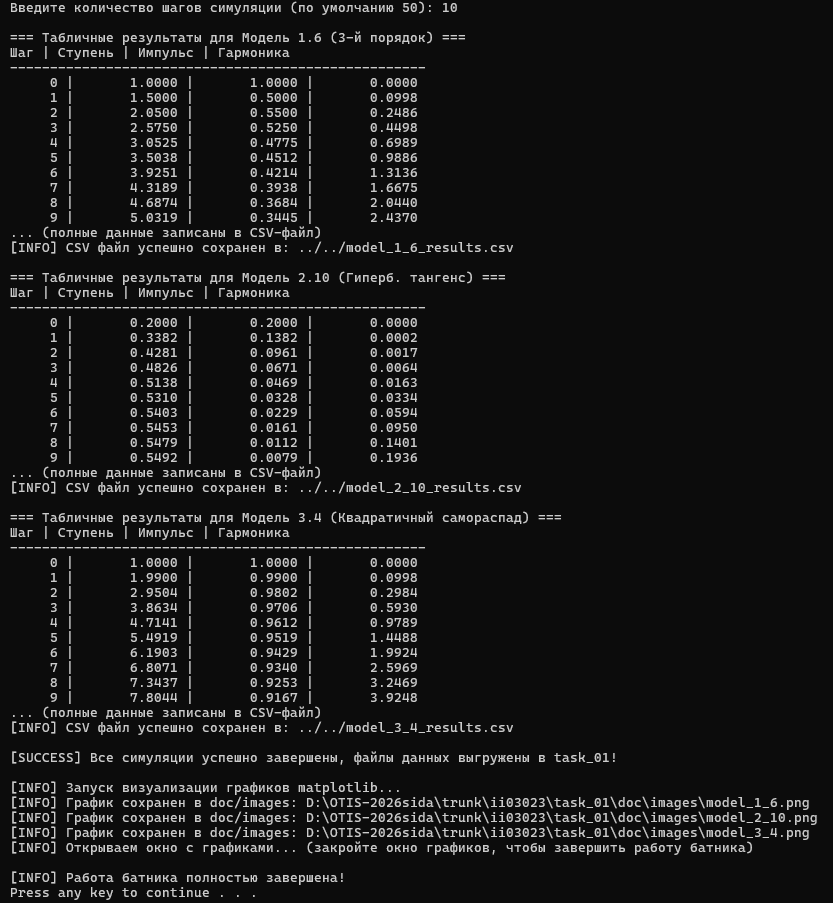
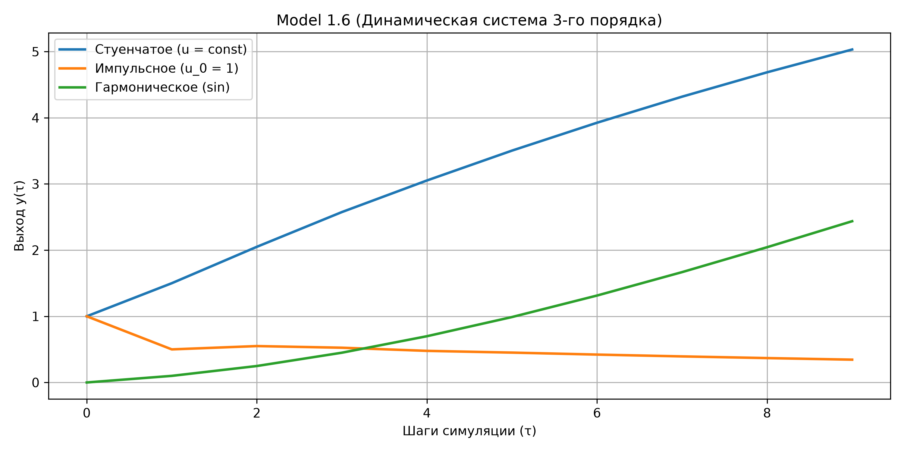
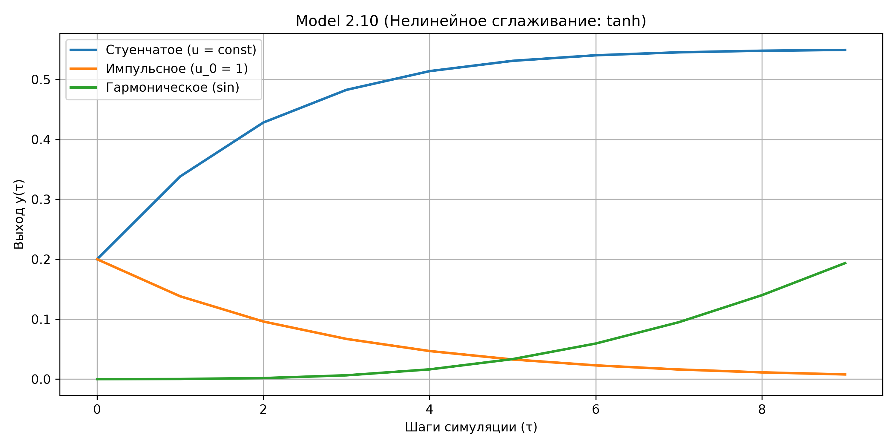
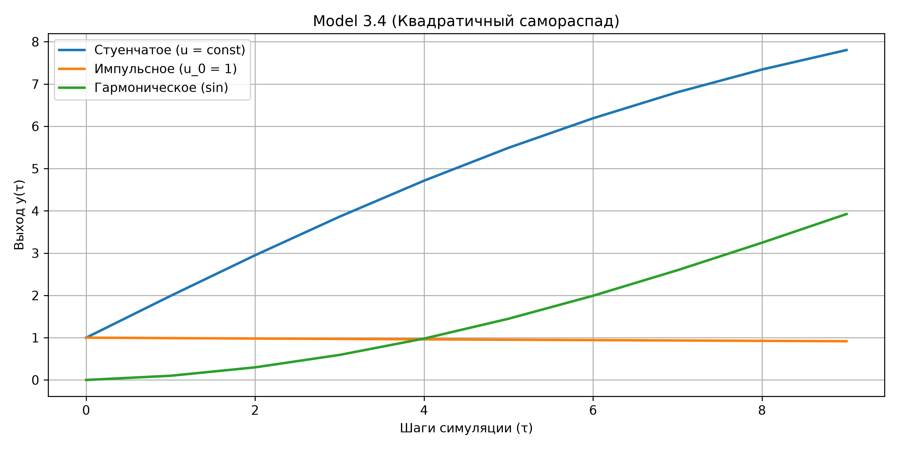
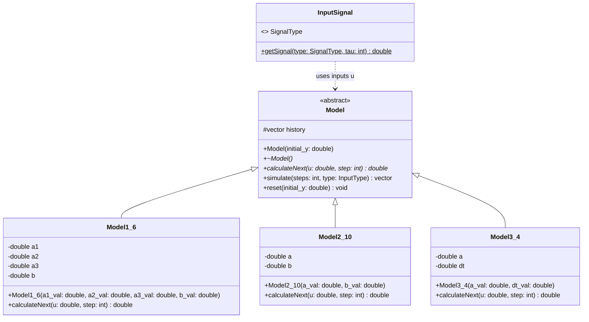

<p align="center">Министерство образования Республики Беларусь</p>
<p align="center">Учреждение образования</p>
<p align="center">«Брестский государственный технический университет»</p>
<p align="center">Кафедра ИИТ</p>
<br><br><br><br><br>
<p align="center"><b>Лабораторная работа №1</b></p>
<p align="center"><b>По дисциплине: «Общая теория интеллектуальных систем»</b></p>
<p align="center"><b>Тема: «Моделирование динамических систем»</b></p>
<br><br><br><br>
<p align="right">Выполнил:</p>
<p align="right">Студент 2 курса</p>
<p align="right">Группы ИИ-30</p>
<p align="right">Сидюк А. П.</p>
<p align="right">Проверил:</p>
<p align="right">Дворанинович Д. А.</p>
<br><br><br><br>
<p align="center">Брест 2026</p>

---

## Вариант 16

- Линейная модель: **Model 1.6**
- Нелинейная модель: **Model 2.10**
- Дифференциальное уравнение: **Model 3.4**

## Реализованные модели

| Блок | Модель | Тип | Название |
|:--:|:--:|:--:|---|
| 1 | 1.6 | линейная дискретная | Third-Order Dynamic System |
| 2 | 2.10 | нелинейная дискретная | Hyperbolic Tangent Smoothing |
| 3 | 3.4 | дифференциальное уравнение |Quadratic Self-Decay |

## Входные воздействия

1. Ступенчатое: `u(t) = A`
2. Импульсное: `u(0) = A`, `u(t > 0) = 0`
3. Гармоническое: `u(t) = A * sin(t)`

## ООП

Создан абстрактный базовый класс `Model` с чисто виртуальным методом `calculateNext(double u, int step)`.

От него наследуются классы конкретных моделей:
- `Model1_6`
- `Model2_10`
- `Model3_4`

## Результат

Программа:
- моделирует все три системы варианта;
- симулирует отклик на все три типа входных воздействий (ступенчатое, импульсное, гармоническое);
- позволяет задать количество шагов `n`;
- выводит результаты в табличном виде;
- сохраняет результаты в `model_1_6_results.csv, model_2_10_results.csv, model_3_4_results.csv`;
- визуализирует графики через Python/Matplotlib.

## Пример работы программы

### Сборка и запуск

Сборка осуществляется с помощью файла `build.bat`:

```bat
@echo off
chcp 65001 > nul
echo [INFO] Создание папки сборки в task_01...
if not exist build mkdir build
cd build

echo [INFO] Запуск CMake...
cmake -G "Visual Studio 17 2022" -A x64 ../src
if %errorlevel% neq 0 (
    echo [ERROR] Ошибка конфигурации CMake!
    pause
    exit /b %errorlevel%
)

echo [INFO] Сборка проекта (Release)...
cmake --build . --config Release
if %errorlevel% neq 0 (
    echo [ERROR] Ошибка компиляции!
    pause
    exit /b %errorlevel%
)

echo [INFO] Сборка успешно завершена!
echo [INFO] Запуск C++ программы для расчета и выгрузки .csv...
cd Release
if exist task_01.exe (
    task_01.exe
) else (
    ..\task_01.exe
)

:: Возвращаемся в корень task_01
cd ..\..

echo.
echo [INFO] Запуск визуализации графиков matplotlib...
if exist src\plot_results.py (
    python src\plot_results.py
) else (
    echo [ERROR] Файл src\plot_results.py не найден!
)

echo.
echo [INFO] Работа батника полностью завершена!
pause
```

После сборки исполняемый файл запускается автоматически либо вручную из каталога `build/src`.

### Демонстрация исполняемого файла task_01.exe:



При запуске исполняемого файла мы получаем результат в `.csv` файлах, после чего автоматически запускается `src/plot_results.py` для визуализации ответа:

### График переходных процессов Model 1.6


### График переходных процессов Model 2.10


### График переходных процессов Model 3.4


## UML Диаграмма классов

