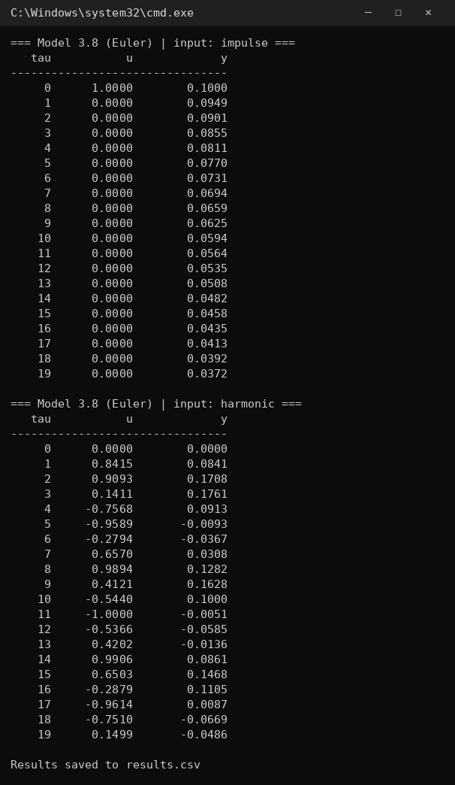
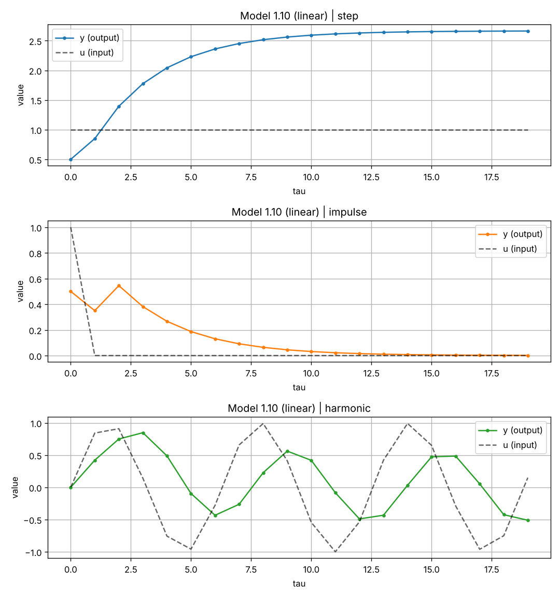
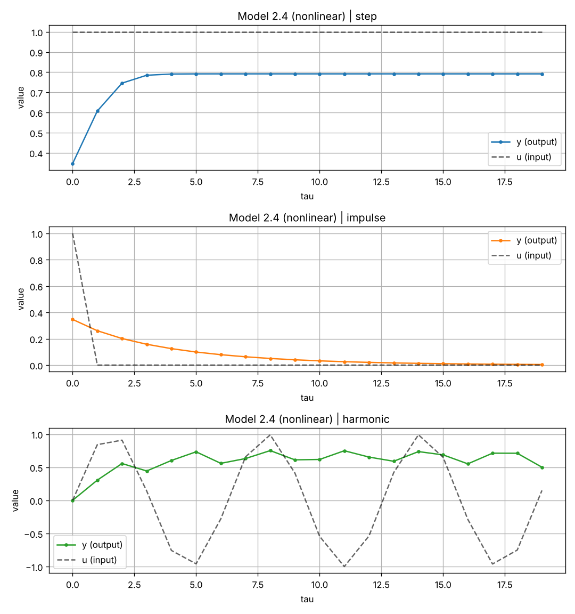
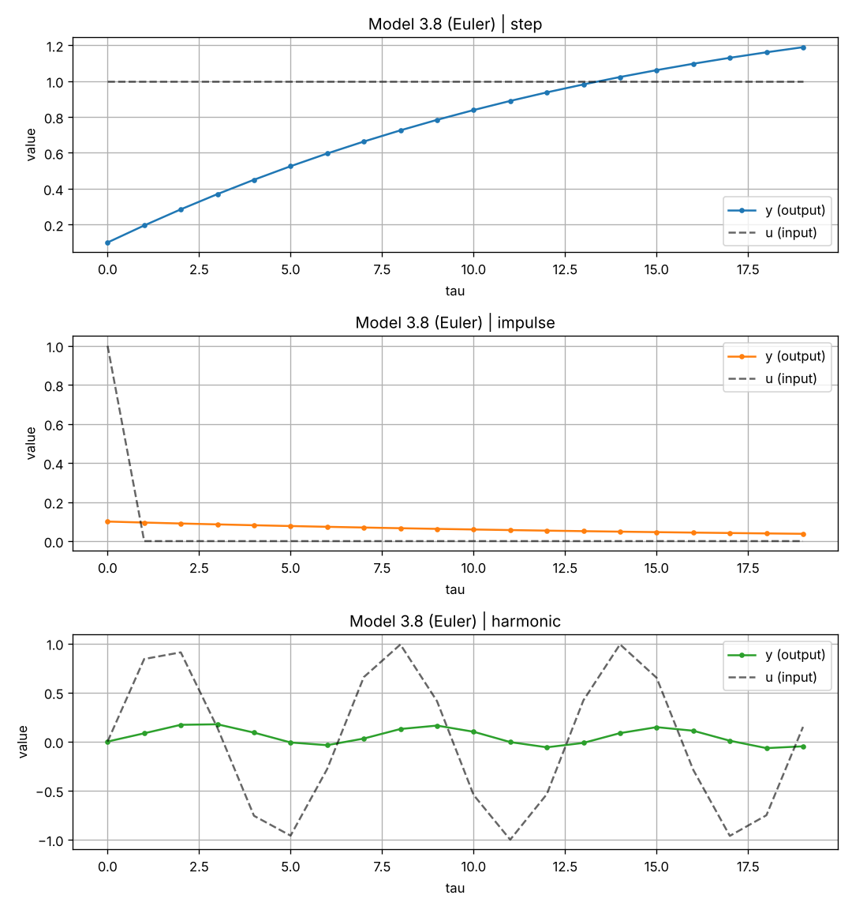
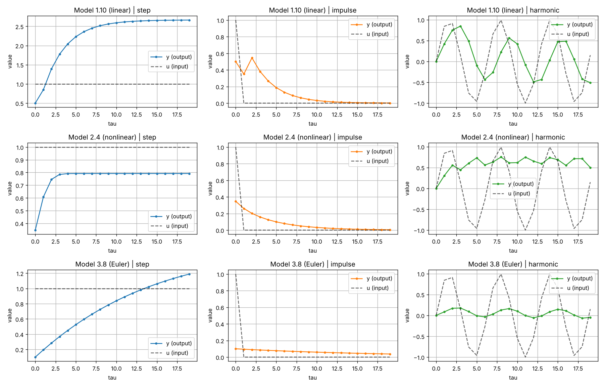
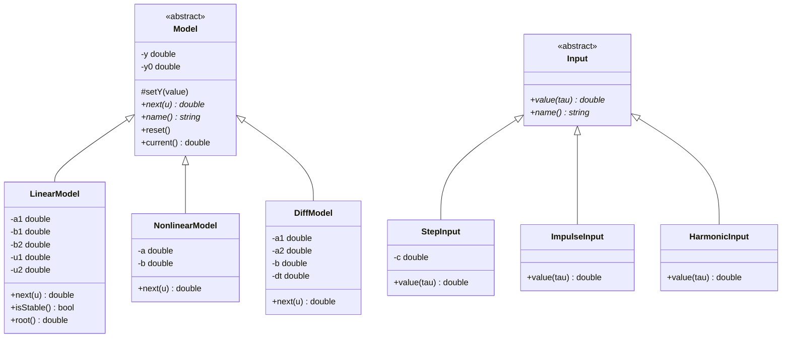

<p align="center"> Министерство образования Республики Беларусь</p>
<p align="center">Учреждение образования</p>
<p align="center">“Брестский Государственный технический университет”</p>
<p align="center">Кафедра ИИТ</p>
<br><br><br><br><br><br><br>
<p align="center">Лабораторная работа №1</p>
<p align="center">По дисциплине “Общая теория интеллектуальных систем”</p>
<p align="center">Тема: “Моделирование линейных, нелинейных и дифференциальных объектов”</p>
<br><br><br><br><br>
<p align="right">Выполнил:</p>
<p align="right">Студент 2 курса</p>
<p align="right">Группы ИИ-30</p>
<p align="right">Громов И. С.</p>
<p align="right">Проверил:</p>
<p align="right">Дворанинович Д. А.</p>
<br><br><br><br><br>
<p align="center">Брест 2026</p>


## Вариант 20

- Линейная модель: **Model 1.10**
- Нелинейная модель: **Model 2.4**
- Дифференциальное уравнение: **Model 3.8**

## Реализованные модели

### Model 1.10 (Distributed Control Window Model)

`y(t+1) = a1*y(t) + b1*u(t) + b2*u(t-2)`

Линейная модель: выход зависит от текущего выхода, текущего входа и входа, поданного два шага назад (запаздывание).

### Model 2.4 (Logarithmic Multi-Variable Interaction)

`y(t+1) = a*y(t)*cos(y(t)) + b*ln(1 + |u(t)|)`

Нелинейная модель: содержит `cos(y)` и логарифм от модуля входа.

### Model 3.8 (Combined Linear-Quadratic Decay)

`dy/dt = -a1*y - a2*y^2 + b*u`

Для Model 3.8 используется метод Эйлера:

`y(t+1) = y(t) + dt*(-a1*y(t) - a2*y(t)^2 + b*u(t))`

### Значения по умолчанию

| Модель | Параметры |
|---|---|
| 1.10 | `a1 = 0.7`, `b1 = 0.5`, `b2 = 0.3` |
| 2.4 | `a = 0.8`, `b = 0.5` |
| 3.8 | `a1 = 0.5`, `a2 = 0.1`, `b = 1`, `dt = 0.1` |

Начальное значение `y0 = 0`, уровень ступеньки `c = 1`. Все значения можно изменить при запуске программы.

## Входные воздействия

1. Ступенчатое: `u(t) = c`
2. Импульсное: `u(0) = 1`, `u(t > 0) = 0`
3. Гармоническое: `u(t) = sin(t)`

## Анализ устойчивости (Advanced Level)

Для Model 1.10 однородная часть уравнения: `y(t+1) = a1*y(t)`.
Характеристическое уравнение `z - a1 = 0`, корень `z = a1`.

Система устойчива, если корень лежит внутри единичной окружности на Z-плоскости: `|a1| < 1`.
Если пользователь вводит `|a1| >= 1`, программа перед началом симуляции выводит предупреждение:

```
WARNING: root of characteristic equation z = 1.1, |z| >= 1 -> system is UNSTABLE (process will diverge)!
```

## ООП

Создан абстрактный базовый класс `Model` с виртуальным методом `next(u)` для расчёта следующего шага симуляции.

От него наследуются:

- `LinearModel` — Model 1.10
- `NonlinearModel` — Model 2.4
- `DiffModel` — Model 3.8

Входные воздействия также реализованы через абстрактный класс `Input` с виртуальным методом `value(tau)`.

От него наследуются:

- `StepInput` — ступенчатое
- `ImpulseInput` — импульсное
- `HarmonicInput` — гармоническое

## Результат

Программа:

- позволяет выбрать модель (одну или все);
- позволяет выбрать входное воздействие (одно или все);
- позволяет задать количество шагов `n`;
- принимает начальное значение `y0`, уровень ступеньки и коэффициенты моделей (Enter — значение по умолчанию);
- проверяет устойчивость линейной модели;
- выводит результаты в табличном виде;
- сохраняет результаты в `results.csv`;
- строит графики через Python/Matplotlib: на каждом графике выход `y` (сплошная линия) и вход `u` (пунктир).

## Пример работы программы:

### Сборка

На Windows build.bat:

```bat
@echo off
chcp 65001 > nul
cd /d "%~dp0"

echo ===== [1/4] CMake configure =====
cmake -S . -B build
if errorlevel 1 goto error

echo ===== [2/4] CMake build =====
cmake --build build --config Release
if errorlevel 1 goto error

set "EXE="
if exist "build\Release\ii03023_lab1.exe" set "EXE=build\Release\ii03023_lab1.exe"
if exist "build\Debug\ii03023_lab1.exe" set "EXE=build\Debug\ii03023_lab1.exe"
if exist "build\ii03023_lab1.exe" set "EXE=build\ii03023_lab1.exe"
if not defined EXE goto notfound
echo Program: %EXE%

:run
echo.
echo ===== [3/4] Run program =====
if exist results.csv del results.csv
"%EXE%"
if not exist results.csv goto noresults

echo.
echo ===== [4/4] Plot (Python + matplotlib) =====
python plot.py
goto ask

:noresults
echo results.csv was not created, skipping plot.

:ask
echo.
set "AGAIN="
set /p AGAIN="Run again with another model/input? (y/n): "
if /i "%AGAIN%"=="y" goto run
echo ===== DONE =====
exit /b 0

:notfound
echo Program ii03023_lab1.exe was not found after build.
echo Check that CMakeLists.txt contains: add_executable(ii03023_lab1 main.cpp models.h)
goto error

:error
echo BUILD FAILED
pause
exit /b 1
```

Скрипт собирает проект, запускает программу, строит графики и предлагает запустить программу ещё раз с другой моделью или входным воздействием.

### Демонстрация исполняемого файла ii03023_lab1.exe:


Меню выбора, ввод значений (Enter — значение по умолчанию), проверка устойчивости и первая таблица.



Последние таблицы (Model 3.8, импульсное и гармоническое воздействия) и сохранение результатов.

При запуске исполняемого файла мы получаем результат в файле results.csv, после чего автоматически запускается plot.py для визуализации ответа (значения по умолчанию, `n = 20`):

## Демонстрация Model 1.10 (линейная)


При ступенчатом входе выход выходит на установившееся значение `(b1 + b2) / (1 - a1) ≈ 2.67`. При импульсе на шаге 2 виден второй всплеск от слагаемого `b2*u(t-2)`, затем выход затухает. При гармоническом входе выход колеблется с той же частотой.

## Демонстрация Model 2.4 (нелинейная)


При ступенчатом входе выход быстро выходит на ≈ 0.79. При гармоническом входе выход остаётся положительным из-за модуля `|u|` под логарифмом.

## Демонстрация Model 3.8 (дифференциальное уравнение)


При ступенчатом входе выход плавно растёт к ≈ 1.53 (корень уравнения `-0.5y - 0.1y^2 + 1 = 0`). На гармонический вход модель реагирует слабо — сглаживает быстрые колебания.

## Сводный график



## UML


