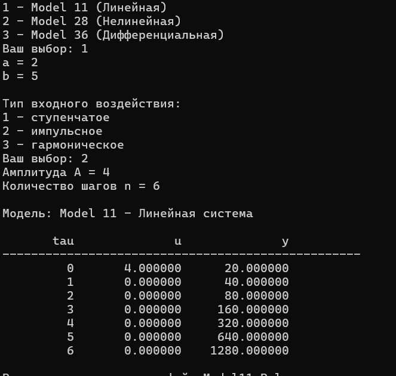
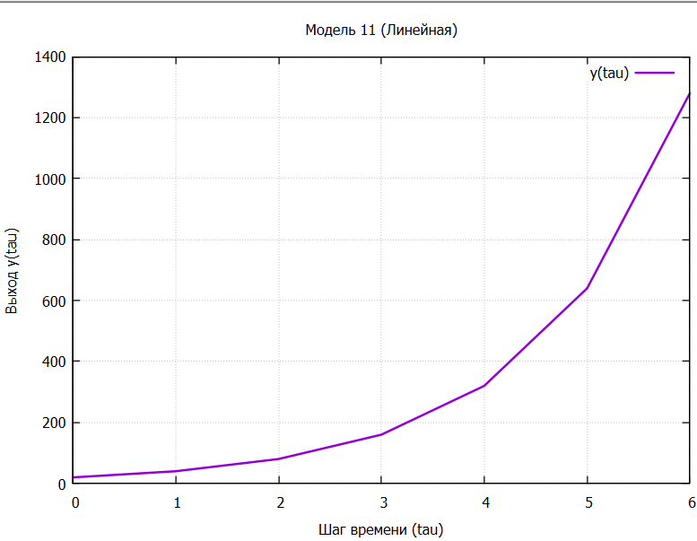

Министерство образования Республики Беларусь
 

Учреждение образования
 

“Брестский государственный технический университет”
 

Кафедра ИИТ
 

       

Лабораторная работа №1
 

По дисциплине “Общая теория интеллектуальных систем”
 

Тема: “Моделирование температуры объекта”
 

     

Выполнила:
 

Студентка 2 курса
 

Группы ИИ-30
 

Стельмашук А. К.
 

Проверил:
 

Дворанинович Д. А.
 

     

Брест 2026

## Цель работы

Изучить принципы математического моделирования динамических систем, реализовать заданные модели с использованием объектно-ориентированного подхода и исследовать их поведение при различных входных воздействиях.

## Вариант 26

В соответствии с заданным вариантом необходимо реализовать следующие модели:

- Линейная модель — **Model 1.1**
- Нелинейная модель — **Model 2.8**
- Дифференциальное уравнение — **Model 3.6**

## Реализованные модели

### Model 1.1 — Standard First-Order Inertial System

Для моделирования используется разностное уравнение инерционного звена первого порядка:

$$y_{\tau+1} = a \cdot y_\tau + b \cdot u_\tau$$

где:
- $y_\tau$ — текущее значение выходного сигнала;
- $u_\tau$ — входное воздействие;
- $a, b$ — коэффициенты модели.

На каждом шаге вычисляется новое значение $y_{\tau+1}$.

### Model 2.8 — Chaotic Logistic Map Disturbance

Нелинейная модель с логистическим отображением и гармонической помехой задаётся выражением:

$$y_{\tau+1} = a \cdot y_\tau \cdot (1 - y_\tau) + b \cdot u_\tau + c \cdot \sin(y_{\tau-1} \cdot u_\tau)$$

где:
- $y_\tau$ — текущее значение выходной величины;
- $y_{\tau-1}$ — значение выходной величины на предыдущем шаге;
- $u_\tau$ — входное воздействие;
- $a, b, c$ — коэффициенты модели.

### Model 3.6 — Cubic Growth and Control

Дифференциальное уравнение с кубической нелинейностью имеет вид:

$$\frac{dy}{dt} = a \cdot y^3 + b \cdot u$$

Для численного решения используется метод Эйлера.

Формула расчёта:

$$y_{\tau+1} = y_\tau + dt \cdot (a \cdot y_\tau^3 + b \cdot u_\tau)$$

где:
- $dt$ — шаг интегрирования;
- $a, b$ — коэффициенты модели;
- $u_\tau$ — входное воздействие;
- $y_\tau$ — текущее значение выходной величины.

## Входные воздействия

Для исследования моделей были реализованы три вида входных воздействий.

### 1. Ступенчатое воздействие

При ступенчатом воздействии значение входного сигнала постоянно:

$$u_\tau = A$$

где $A$ — заданная амплитуда.

### 2. Импульсное воздействие

Для импульсного воздействия используется:

$$u_0 = A, \quad u_\tau = 0 \text{ при } \tau > 0$$

То есть сигнал имеет заданное значение только на первом временном шаге, после чего становится равным нулю.

### 3. Гармоническое воздействие

Гармоническое воздействие задаётся формулой:

$$u_\tau = A \cdot \sin(\tau)$$

где $A$ — амплитуда гармонического сигнала.

## Объектно-ориентированная реализация

Для реализации моделей был использован объектно-ориентированный подход.

Создан абстрактный базовый класс `Model`, содержащий виртуальный метод `calculateNext()`. Данный метод отвечает за вычисление следующего значения выходного сигнала.

От базового класса наследуются три специализированных класса:

- `Model1_1` — линейная модель;
- `Model2_8` — нелинейная модель;
- `Model3_6` — модель дифференциального уравнения.

Каждый дочерний класс реализует собственную формулу вычисления.

## Работа программы

После запуска программы пользователю предлагается выбрать модель для исследования. Далее вводятся необходимые параметры модели и выбирается тип входного воздействия.

Программа позволяет:
- выбрать одну из трёх моделей;
- ввести коэффициенты модели;
- выбрать тип входного воздействия;
- задать амплитуду сигнала;
- задать количество временных шагов;
- выполнить моделирование;
- вывести полученные значения в консоль;
- использовать полученные данные для построения графика.

## Сборка программы

Для сборки проекта используется система **CMake**. На Windows запуск сборки осуществляется с помощью файла `build.bat`.

## Демонстрация работы программы

---

## Вывод
В ходе лабораторной работы были изучены основные принципы моделирования динамических систем. Были реализованы линейная модель Model 11, нелинейная модель Model 28 и модель дифференциального уравнения Model 36.

Для каждой модели была реализована возможность работы со ступенчатым, импульсным и гармоническим входными воздействиями. Для решения дифференциального уравнения использовался метод Эйлера.

При разработке программы был применён объектно-ориентированный подход с использованием абстрактного базового класса и наследования. Результаты вычислений выводятся в консоль, сохраняются в CSV-файл и используются для построения графиков.

В результате была получена программа, позволяющая исследовать поведение различных динамических моделей при различных входных воздействиях.