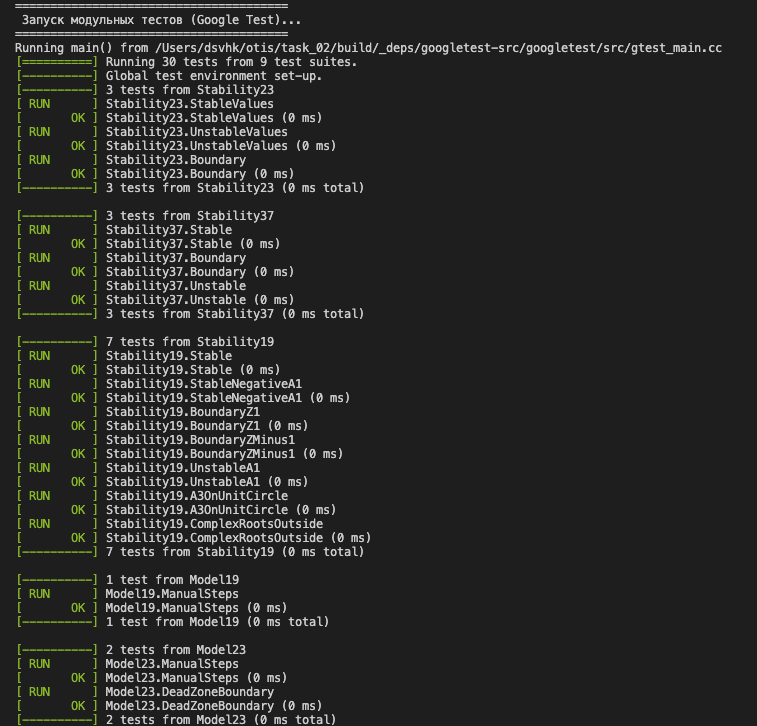
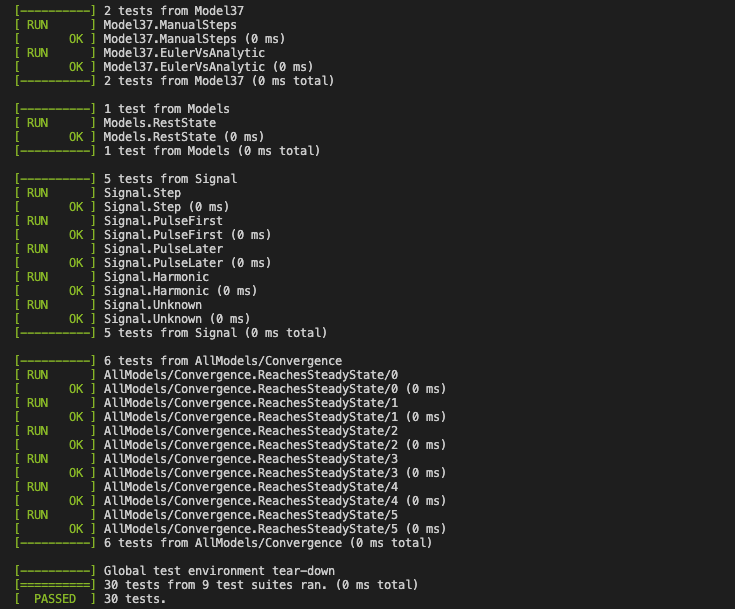
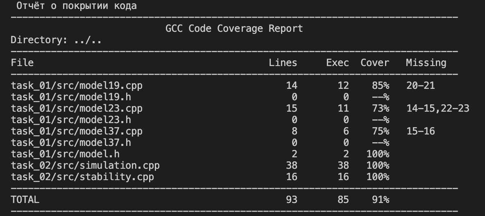

<p align="center"> Министерство образования Республики Беларусь</p>
<p align="center">Учреждение образования</p>
<p align="center">“Брестский Государственный технический университет”</p>
<p align="center">Кафедра ИИТ</p>
<br><br><br><br><br><br><br>
<p align="center">Лабораторная работа №2</p>
<p align="center">По дисциплине “Общая теория интеллектуальных систем”</p>
<p align="center">Тема: “Модульное тестирование и анализ устойчивости моделей”</p>
<br><br><br><br><br>
<p align="right">Выполнил:</p>
<p align="right">Студент 2 курса</p>
<p align="right">Группы ИИ-30</p>
<p align="right">Титова Д.И.</p>
<p align="right">Проверил:</p>
<p align="right">Дворанинович Д. А.</p>
<br><br><br><br><br>
<p align="center">Брест 2026</p>


## Вариант 19.
Линейная модель: Model 1.9
Нелинейная модель: Model 2.3
Дифференциальное уравнение: **Model 3.7**

В данной лабораторной работе программа из лабораторной работы №1 расширена модулем анализа устойчивости и покрыта модульными тестами на фреймворке Google Test.

**Что сделано:**
- добавлен модуль анализа устойчивости (`stability.h`, `stability.cpp`);
- перед началом симуляции программа выводит предупреждение, если введённые коэффициенты дают расходящийся процесс;
- формирование входного сигнала вынесено в отдельную функцию `generateSignal` (`simulation.h`, `simulation.cpp`), чтобы её можно было тестировать;
- написаны модульные тесты (Google Test, в том числе параметризованные `TEST_P`);
- создан скрипт `run_tests.sh`, который собирает проект, запускает тесты и показывает покрытие кода.

## Анализ устойчивости

Устойчивость означает, что при долгой работе модели выход `y` остаётся ограниченным и не растёт до бесконечности. Для линейной дискретной модели она определяется корнями характеристического уравнения: система устойчива, если модули всех корней меньше единицы (`|z| < 1`, корни лежат внутри единичной окружности на Z-плоскости).

Случай `|z| = 1` (граница) считается неустойчивым, так как процесс не затухает.

**Model 1.9**

`y(t+1) = a1*y(t) + a2*y(t-1) + a3*y(t-2) + b1*u(t)`

Характеристическое уравнение:

`z^3 - a1*z^2 - a2*z - a3 = 0`

Система устойчива, если все три корня по модулю меньше 1. В программе это проверяется критерием Джури. Для многочлена `P(z) = z^3 + c2*z^2 + c1*z + c0`, где `c2 = -a1`, `c1 = -a2`, `c0 = -a3`, должны выполняться четыре условия:

- `P(1) > 0`
- `-P(-1) > 0`
- `|c0| < 1`
- `|c0^2 - 1| > |c0*c2 - c1|`

**Model 2.3**

`y(t+1) = a*y(t) + b*deadzone(u(t))`

Характеристическое уравнение: `z - a = 0`, корень `z = a`. Условие устойчивости: `|a| < 1`. Зона нечувствительности является статической нелинейностью и на устойчивость линейной части не влияет.

**Model 3.7**

`y(t+1) = y(t) + dt*(-exp(a)*y(t) + b*u(t)) = (1 - dt*exp(a))*y(t) + dt*b*u(t)`

Характеристическое уравнение: `z - (1 - dt*exp(a)) = 0`, корень `z = 1 - dt*exp(a)`. Условие `|z| < 1` равносильно `0 < dt*exp(a) < 2`, то есть `dt < 2*exp(-a)`. Это условие устойчивости самого метода Эйлера: непрерывная модель `dy/dt = -exp(a)*y + b*u` устойчива всегда, но при слишком большом шаге `dt` численное решение расходится.

## Модульные тесты

Использован фреймворк [Google Test](https://github.com/google/googletest) версии 1.14.0, который подключается через `FetchContent` в `CMakeLists.txt` и скачивается автоматически при первой сборке.

**Что проверяют тесты:**

- **Модуль устойчивости** (`stability_checks.cpp`): устойчивые коэффициенты возвращают `true`, расходящиеся возвращают `false`; граничные случаи `|z| = 1` (например, `a = 1`, `a = -1`, `dt = 2` при `a = 0`, `a3 = 1`); комплексные корни за пределами единичной окружности.
- **Значения моделей, посчитанные вручную** (`model_checks.cpp`): при заранее известных коэффициентах модель возвращает заранее известные значения.
  - Model 1.9, `a1 = 0.5, a2 = 0.2, a3 = 0.1, b1 = 1`, ступенька `u = 1`: `y = 1; 1.5; 1.95`.
  - Model 2.3, `a = 0.5, b = 1, delta = 0.2`, ступенька `u = 1`: `y = 0.8; 1.2`.
  - Model 3.7, `a = 0, b = 1, dt = 0.1`, ступенька `u = 1`: `y = 0.1; 0.19`.
- **Граничные значения нелинейности** (Model 2.3): при `u = delta` и `u = -delta` выход равен нулю (зона нечувствительности).
- **Инвариант покоя**: при `u = 0` и нулевом начальном состоянии все модели остаются в нуле.
- **Метод Эйлера против аналитического решения** (Model 3.7): при `a = 0, b = 1` решение `y(t) = 1 - exp(-t)`, после 1000 шагов с `dt = 0.001` результат совпадает с ним с точностью `1e-3`.
- **Параметризованный тест `TEST_P`**: один тест проверяет сходимость к установившемуся значению для шести наборов параметров разных моделей, без дублирования кода. Установившиеся значения при ступенчатом сигнале `u = 1`:
  - Model 1.9: `b1*u / (1 - a1 - a2 - a3)`
  - Model 2.3: `b*(u - delta) / (1 - a)`
  - Model 3.7: `b*u / exp(a)`
- **Входные сигналы**: проверка функции `generateSignal` для ступенчатого, импульсного и гармонического воздействий и для неизвестного типа сигнала.

## Локальная автоматизация

Так как я работаю на macOS, вместо `run_tests.bat` создан Bash-скрипт `run_tests.sh`. Он пересоздаёт папку `build`, собирает проект, запускает модульные тесты и выводит покрытие кода (`gcovr`).

```sh
#!/bin/bash
set -e

echo "======================================="
echo " Сборка проекта..."
echo "======================================="

rm -rf build
mkdir build
cd build

cmake .. -DCMAKE_BUILD_TYPE=Debug
cmake --build .

echo "======================================="
echo " Запуск модульных тестов (Google Test)..."
echo "======================================="
./tests

echo "======================================="
echo " Отчёт о покрытии кода"
echo "======================================="
gcovr -r .. --gcov-executable "xcrun llvm-cov gcov" \
  --exclude "../test" --exclude ".*_deps.*" --exclude ".*main.cpp"

cd ..
```

## Тестовое покрытие и результаты

* **Всего модульных тестов:** 30
* **Успешно пройденных тестов:** 30 / 30

*Тесты*




*Результаты покрытия кода*


