<p align="center">Министерство образования Республики Беларусь</p>
<p align="center">Учреждение образования</p>
<p align="center">«Брестский государственный технический университет»</p>
<p align="center">Кафедра ИИТ</p>
<br><br><br><br><br><br>
<p align="center"><b>Лабораторная работа №3</b></p>
<p align="center">по дисциплине «Общая теория интеллектуальных систем»</p>
<p align="center">Тема: «Система автоматического управления с ПИД-регулятором»</p>
<br><br><br><br><br>
<p align="right">Выполнила:</p>
<p align="right">студентка 2 курса</p>
<p align="right">группы ИИ-30</p>
<p align="right">Титова Д. И.</p>
<p align="right">Проверил:</p>
<p align="right">Дворанинович Д. А.</p>
<br><br><br><br><br>
<p align="center">Брест 2026</p>


## 1. Цель работы

Объединить в одну программу математические модели объектов управления из первой лабораторной работы и дискретный ПИД-регулятор, получив замкнутую систему автоматического управления. Исследовать, как регулятор выводит выход объекта на заданное значение и как на качество переходного процесса влияют коэффициенты $K_p$, $K_i$, $K_d$. Дополнительно — оформить модульные тесты на Google Test и документацию кода в Doxygen.

Вариант 19. Объекты управления: модель 1.9, модель 2.3, модель 3.7.

## 2. Теоретические сведения

Задача регулятора — по ошибке

$$
e(t) = w(t) - y(t)
$$

где $w$ — заданное значение (уставка), $y$ — выход объекта, выработать управляющее воздействие $u(t)$, подаваемое на вход объекта. Контур замкнут обратной связью: выход объекта возвращается на вход регулятора.

Непрерывный ПИД-закон:

$$
u(t) = K_p e(t) + K_i \int_0^t e(\tau)\,d\tau + K_d \frac{de(t)}{dt}.
$$

Программа работает с дискретным временем (шаг $\Delta t$), поэтому используется инкрементальная (скоростная) форма: регулятор не пересчитывает $u$ целиком, а вычисляет прирост относительно предыдущего значения. Для этого берут разность двух соседних значений непрерывного закона и заменяют интеграл суммой, а производную — конечными разностями:

$$
u_k = u_{k-1} + \Delta u_k,
$$

$$
\Delta u_k = K_p\,(e_k - e_{k-1}) \;+\; K_i\, e_k\, \Delta t \;+\; \frac{K_d}{\Delta t}\,(e_k - 2e_{k-1} + e_{k-2}).
$$

## 3. Реализация

### 3.1. Класс `PIDController`

Объявление в `pid.h`, реализация в `pid.cpp`.

| Член класса | Назначение |
|---|---|
| `kp`, `ki`, `kd` | коэффициенты регулятора |
| `uMin`, `uMax` | границы управляющего сигнала |
| `previousError`, `previousPreviousError` | $e_{k-1}$ и $e_{k-2}$ |
| `control` | предыдущее значение $u_{k-1}$ (состояние регулятора) |
| `calculate(setpoint, output, dt)` | один шаг алгоритма, возвращает $u_k$ |
| `reset()` | обнуляет историю ошибок и управление |

Ключевая часть `calculate`:

```cpp
double error = setpoint - output;

double deltaControl =
    kp * (error - previousError)
    + ki * error * dt
    + kd / dt * (error - 2.0 * previousError + previousPreviousError);

control += deltaControl;

if (control > uMax)      control = uMax;
else if (control < uMin) control = uMin;

previousPreviousError = previousError;
previousError = error;
```

### 3.2. Программа `main.cpp`

Последовательность действий:

1. Выбор объекта из меню: 1 — модель 1.9 (коэффициенты $a_1, a_2, a_3, b_1$), 2 — модель 2.3 ($a$, $b$ и зона нечувствительности), 3 — модель 3.7 ($a$, $b$ и шаг времени). Для моделей 1.9 и 2.3 шаг фиксирован: $\Delta t = 0{,}1$; для модели 3.7 он вводится и должен быть положительным.
2. Ввод заданной температуры и коэффициентов $K_p, K_i, K_d$.
3. Ввод границ управляющего сигнала; проверка `uMin < uMax`.
4. Выбор режима моделирования:
   - **режим 1** — фиксированное число шагов;
   - **режим 2** — до достижения точности: заданы допуск $\varepsilon$ и максимум шагов; моделирование останавливается, когда $|e| \le \varepsilon$ удерживается 10 итераций подряд.
5. Цикл моделирования, вывод строк таблицы на экран и в файл `results.csv`.

Все вводимые параметры проверяются; при некорректных значениях программа сообщает об ошибке и завершается с кодом 1. Если файл результатов не удалось открыть, программа также прекращает работу с сообщением об ошибке.

### 3.3. Построение графиков

`plot.py` читает `results.csv` (модуль `csv`, разделитель `;`) и строит два графика с помощью matplotlib:

1. заданная температура и выход $y(t)$ — переходный процесс, сохраняется в `result.png`;
2. управляющий сигнал $u(t)$ — сохраняется в `control.png`.

## 4. Модульное тестирование

Тесты находятся в `test/test_pid.cpp`, фреймворк — Google Test 1.14.0 (подключается через `FetchContent`). 

| Тест | Параметры | Ожидаемый результат | Что проверяется |
|---|---|---|---|
| `ProportionalControl` | $K_p=2$, $w=10$, $y=0$, $\Delta t=1$ | $2\cdot10 = 20$ | пропорциональный канал |
| `ControlLimit` | $K_p=10$, $u\in[-5;5]$ | $5$ (а не 100) | ограничение сигнала сверху |
| `IntegralControl` | $K_i=2$, $e=5$, $\Delta t=1$ | $2\cdot5\cdot1 = 10$ | интегральный канал |
| `DifferentialControl` | $K_d=2$, $e=5$, $\Delta t=1$ | $\frac{2}{1}\cdot5 = 10$ | дифференциальный канал |
| `ResetController` | расчёт, `reset()`, затем $e=0$ | $0$ | сброс состояния регулятора |
| `ZeroTimeStep` | $\Delta t=0$ | $0$ | защита от деления на ноль |

> *Рис. 1. Прохождение модульных тестов*

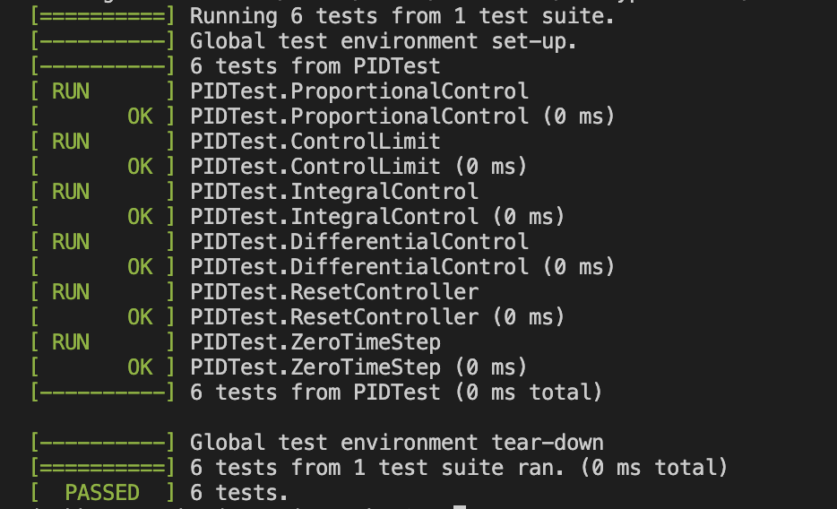

## 5. Документация Doxygen

Конфигурация `Doxyfile`: входная папка `src`, выходная `doc`, формат HTML (`doc/html`), LaTeX отключён, `EXTRACT_ALL = YES`. Генерация: `doxygen Doxyfile`, стартовая страница — `doc/html/index.html`.

> *Рис. 2. Страница сгенерированной документации*

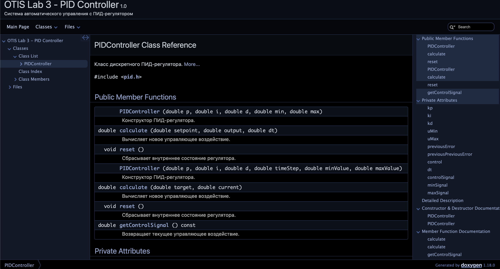

## 6. Результаты моделирования

### 6.1. Модель 1.9

Параметры: $a_1 = 0.5$, $a_2 = 0.2$, $a_3 = 0.1$, $b_1 = 1$; $w = 10$; ПИД: $K_p = 0.3$, $K_i = 1$, $K_d = 0.01$; $u \in [-100;100]$; режим 1, $n = 50$.

*Рис. 3. Переходный процесс, модель 1.9*

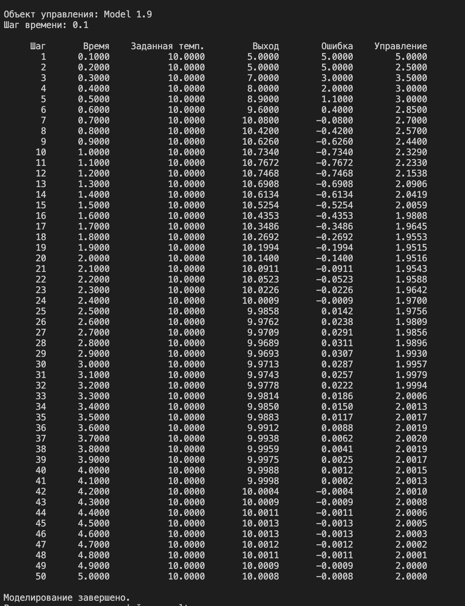

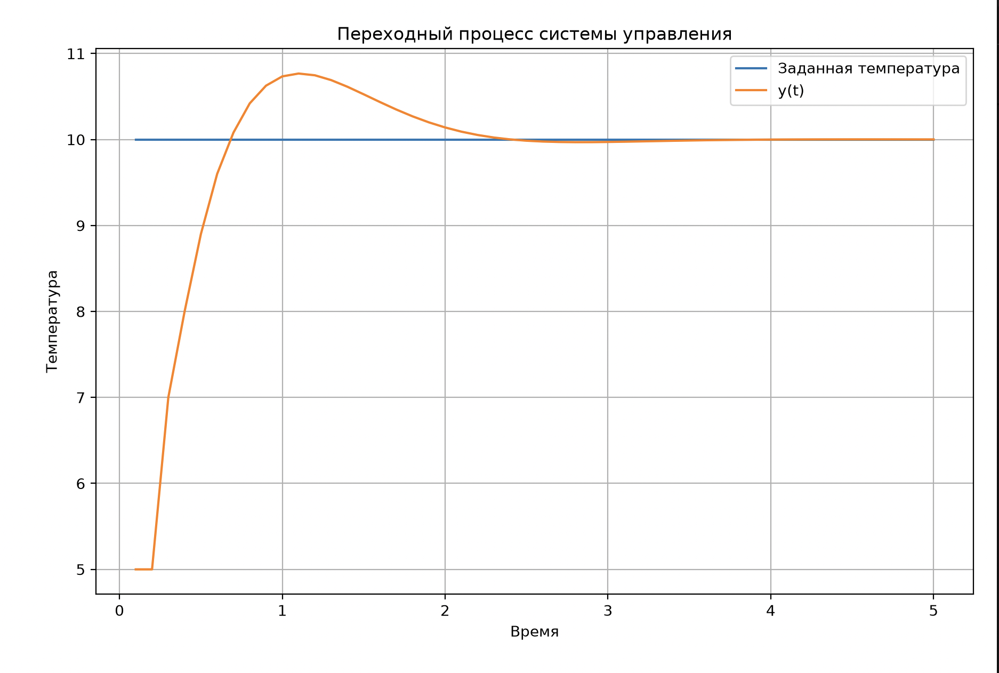

*Рис. 4. Управляющий сигнал, модель 1.9*

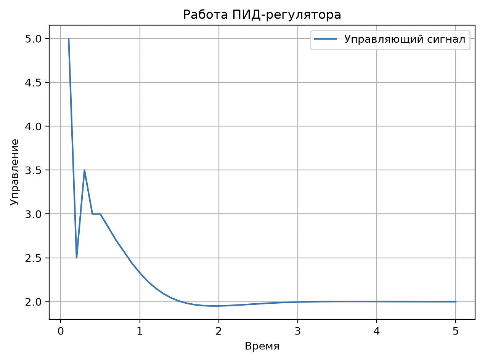

### 6.2. Модель 2.3

Параметры: $a = 0.5$, $b = 1$, зона нечувствительности $= 0.5$; $w = 10$; ПИД: $K_p = 0.3$, $K_i = 1$, $K_d = 0.01$, $u \in [-100;100]$; режим 1, $n = 50$.

*Рис. 5. Переходный процесс, модель 2.3*

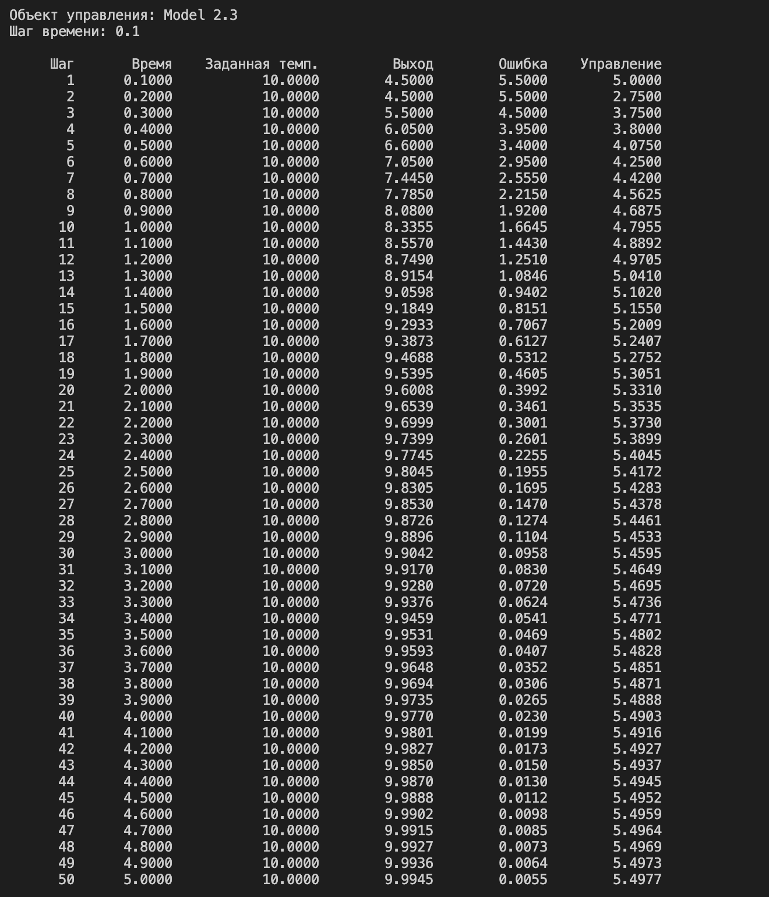

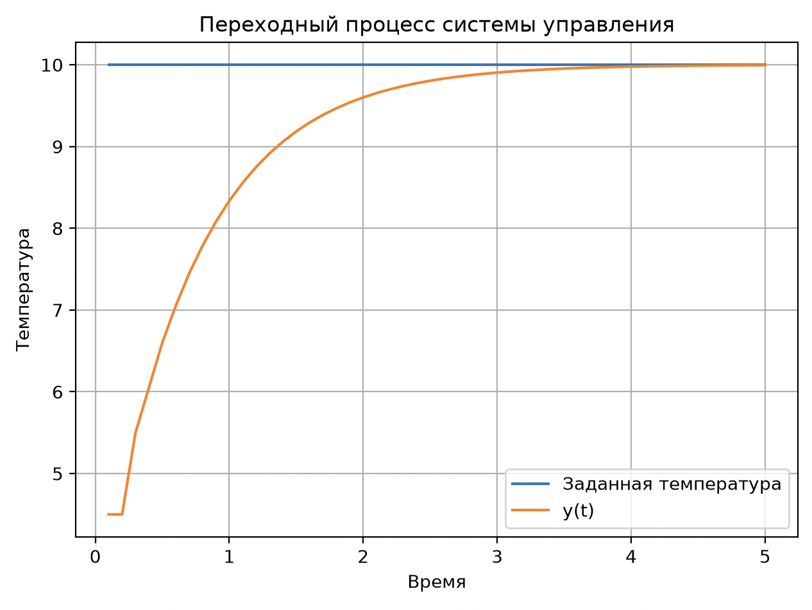

*Рис. 6. Управляющий сигнал, модель 2.3*

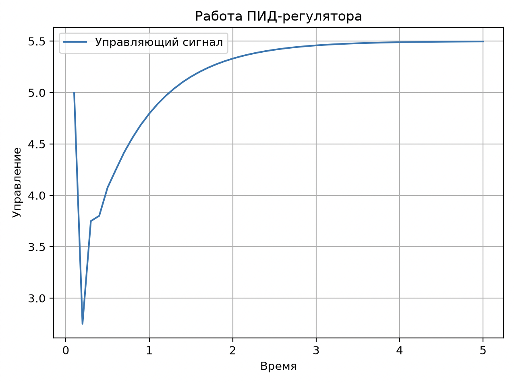

### 6.3. Модель 3.7

Параметры: $a = 0.5$, $b = 1$, $\Delta t = 0.1$; $w = 10$; ПИД: $K_p = 0.3$, $K_i = 1$, $K_d = 0.01$, $u \in [-100;100]$; режим 1, $n = 50$.

*Рис. 7. Переходный процесс, модель 3.7*

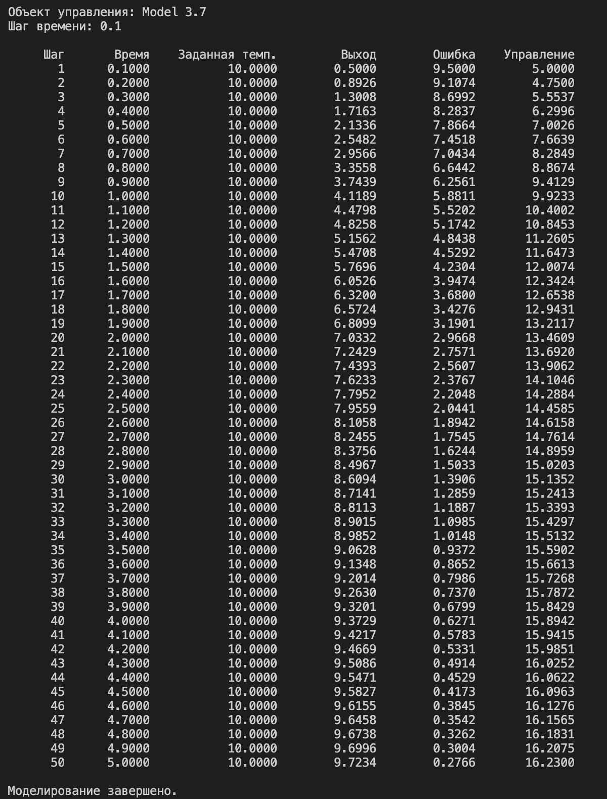

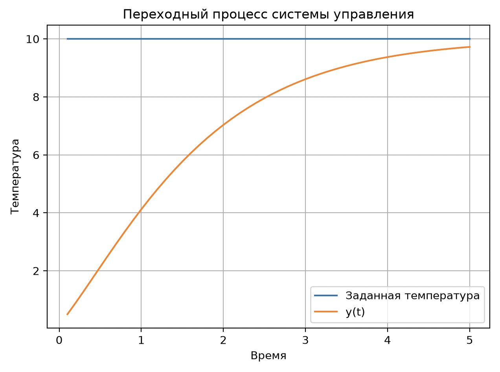

*Рис. 8. Управляющий сигнал, модель 3.7*

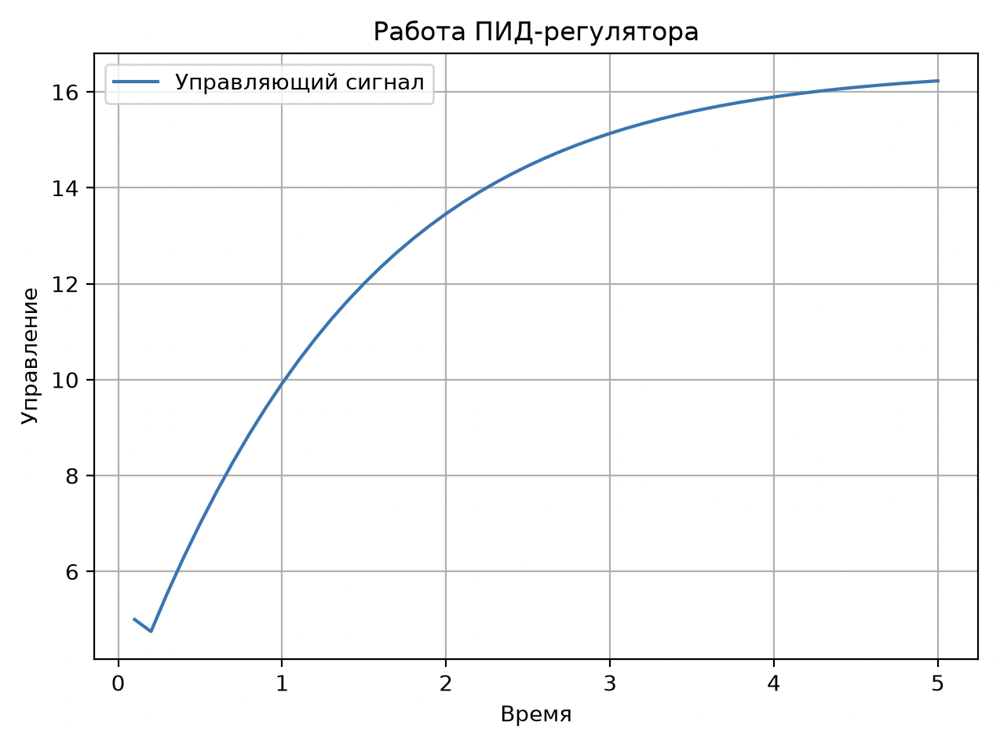


## 7. Выводы

1. Реализована замкнутая система управления: ПИД-регулятор в инкрементальной форме работает с любой из трёх моделей лабораторной работы №1, выбираемой в меню.
2. Регулятор оформлен отдельным классом `PIDController` с ограничением управляющего сигнала, защитой от нулевого шага и методом сброса состояния.
3. Реализовано два режима моделирования: по заданному числу шагов и до достижения требуемой точности.
4. Правильность реализации каждого канала регулятора проверена шестью модульными тестами с ручным расчётом ожидаемых значений.
5. Код документирован в Doxygen, сборка автоматизирована скриптом `build.sh`, результаты экспортируются в CSV и визуализируются в Python.
