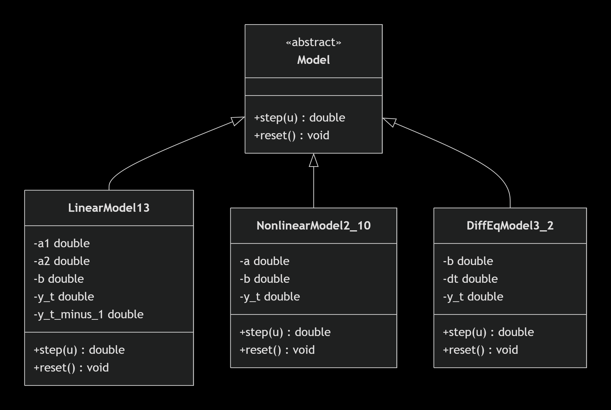
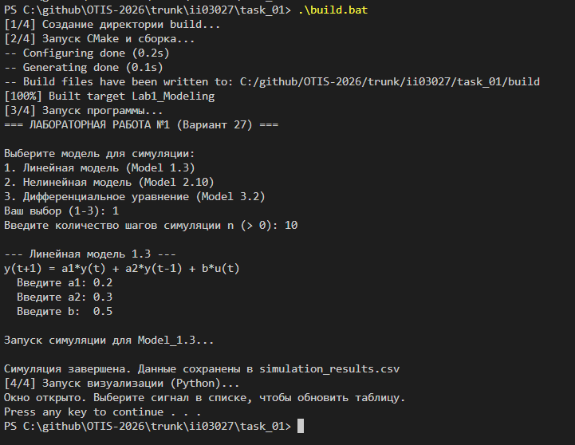
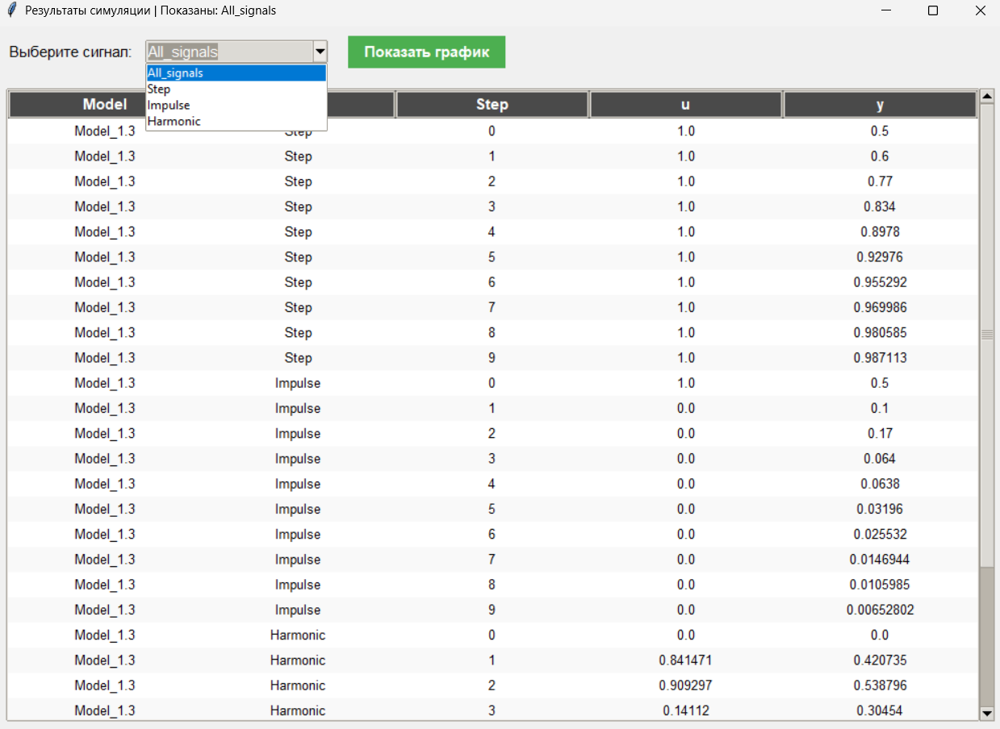
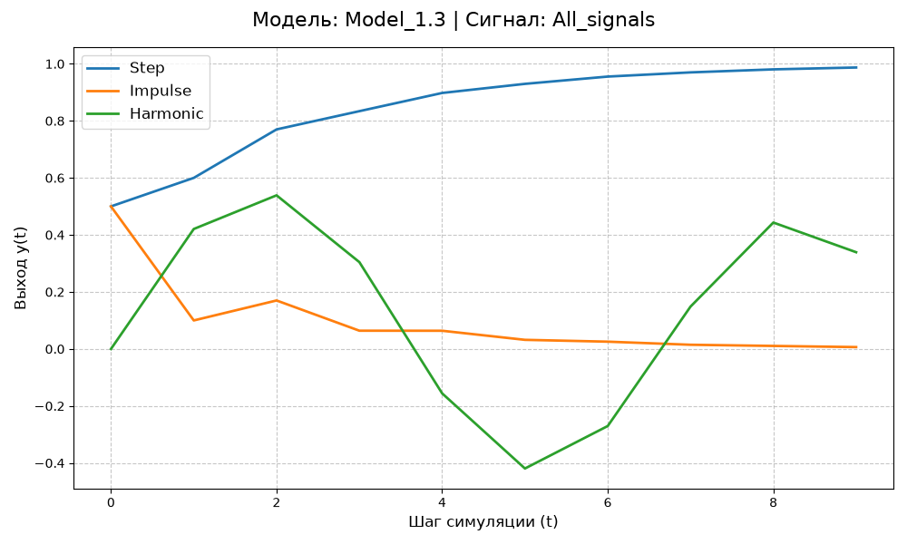
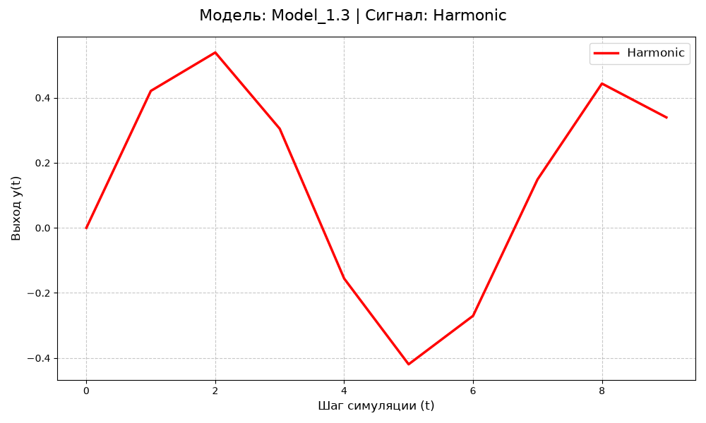
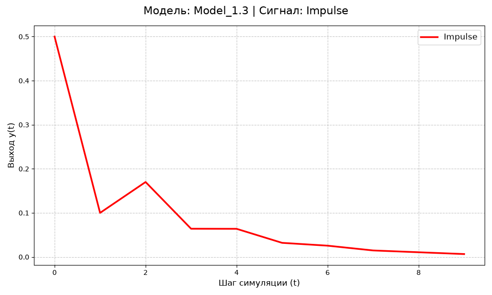
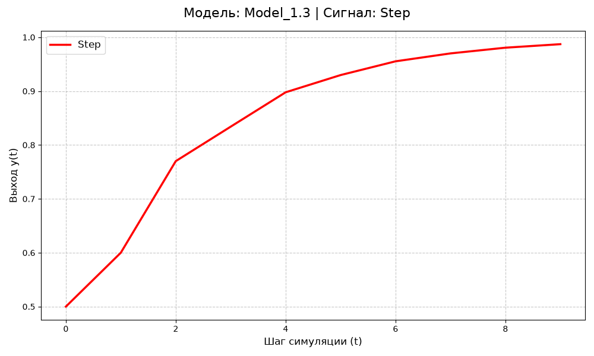

<p align="center"> Министерство образования Республики Беларусь</p>
<p align="center">Учреждение образования</p>
<p align="center">“Брестский Государственный технический университет”</p>
<p align="center">Кафедра ИИТ</p>
<br><br><br><br><br><br><br>
<p align="center">Лабораторная работа №1</p>
<p align="center">По дисциплине “Общая теория интеллектуальных систем”</p>
<p align="center">Тема: “Моделирования температуры объекта”</p>
<br><br><br><br><br>
<p align="right">Выполнил:</p>
<p align="right">Студент 2 курса</p>
<p align="right">Группы ИИ-30</p>
<p align="right">Шульжик К. О.</p>
<p align="right">Проверил:</p>
<p align="right">Дворанинович Д. А.</p>
<br><br><br><br><br>
<p align="center">Брест 2026</p>


## Вариант

- Линейная модель: **Model 1.3**
- Нелинейная модель: **Model 2.10**
- Дифференциальное уравнение: **Model 3.2**

## Реализованные модели

### Model 1.3

`y(t+1) = a1*y(t) + a2*y(t-1) + b*u(t)`

### Model 2.10

`y(t+1) = a*tanh(y(t)) + b*u(t)^3`

### Model 3.2

`dy/dt = b*u`

Для Model 3.2 используется метод Эйлера:

`y(t+1) = y(t) + dt*(b*u(t))`

## Входные воздействия

1. Ступенчатое: `u(t) = 1`
2. Импульсное: `u(0) = 1`, `u(t > 0) = 0`
3. Гармоническое: `u(t) = sin(t)`

## ООП

Создан абстрактный базовый класс `Model` с виртуальным методом `step()`.

От него наследуются:

- `LinearModel13`
- `NonlinearModel2_10`
- `DiffEqModel3_2`

## UML



## Результат

Программа:

- позволяет выбрать модель (в текущей реализации прогоняются все 3 модели подряд);
- принимает количество шагов `n`;
- прогоняет каждую модель через 3 входных воздействия;
- выводит результаты в табличном виде в консоль;
- сохраняет результаты в `simulation_results.csv`;
- позволяет построить графики через Python/Matplotlib (скрипт `plot.py`).

## Пример работы программы:

### Сборка

На Windows используется файл `build.bat`. Скрипт автоматически собирает проект, запускает его и вызывает Python для построения графиков:

```bat
@echo off
chcp 65001 >nul
echo [1/4] Создание директории build...
if not exist build mkdir build
cd build

echo [2/4] Запуск CMake и сборка...
cmake -G "MinGW Makefiles" ..
cmake --build . --config Release

echo [3/4] Запуск программы...
if exist Release\Lab1_Modeling.exe (
    echo 10 | Release\Lab1_Modeling.exe
) else (
    echo 10 | Lab1_Modeling.exe
)

echo [4/4] Запуск визуализации (Python)...
cd ..
python plot.py

pause
```

## Демонстрация исполняемого файла:



## Демонстрация результатов моделирования:










